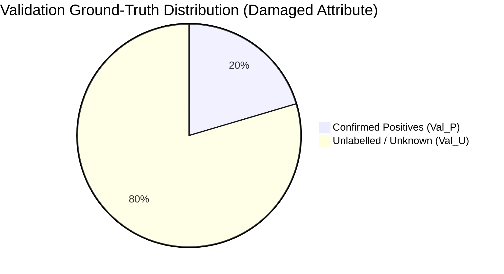

# RiceAge AI — Automated Model Validation Protocol
**Document Version:** 1.0.0  
**Phase:** 2 — Fully Automated Model Improvement  
**Effective Date:** October 31, 2026  
**Status:** Certified Validation Protocol  

---

## 1. Executive Mandate: Statistical Integrity Under Incomplete Supervision

In the RiceAge validation universe ($N = 4,944$ eligible canonical instances across 32 scans), negative defect labels are largely unconfirmed:
- **Damaged:** 1,009 confirmed positives, 3,935 unlabelled.
- **Chalky:** 327 confirmed positives, 59 confirmed negatives, 4,558 unlabelled.
- **Discoloured:** 52 confirmed positives, 4,892 unlabelled.
- **Husk State:** 37 confirmed positives, 4,907 unlabelled.

> [!CAUTION]
> **Strict Prohibition Against Unverified Classical Metrics:**  
> When unlabelled validation instances contain an unknown fraction of true positives and true negatives, reporting classical **Accuracy, Precision, Specificity, or F1 Score against the unlabelled set is mathematically invalid and scientifically fraudulent**.  
> Computing $F_1 = 2TP / (2TP + FP + FN)$ by treating unlabelled instances as negative penalizes the model whenever it correctly predicts an unlabelled positive as positive, falsely deflating precision!

---

## 2. Statistically Valid Evaluation Metrics

All model comparisons, ablation studies, and checkpoint selections must be conducted using the following five statistically sound metrics:

### 2.1 Metric 1: Recall on Confirmed Positives ($R_P@\tau$)
Measures the proportion of historical, confirmed positive validation examples correctly identified above threshold $\tau \in [0.1, 0.9]$:
$$R_P(\tau) = \frac{\sum_{i \in \text{Val}_P} \mathbb{I}(g(x_i) \ge \tau)}{|\text{Val}_P|}$$
- Standard Operating Threshold: $\tau = 0.50$.
- Conservative High-Precision Threshold: $\tau = 0.80$.

### 2.2 Metric 2: Positive Retrieval Rate / Area Under Positive Retrieval Curve (AU-PRC)
Evaluates the model's ranking ability to place confirmed positives at the top of the predicted score distribution across the entire validation split ($N = 4,944$):
$$\text{Recall}@K = \frac{|\text{Top}_K(g) \cap \text{Val}_P|}{|\text{Val}_P|}$$
Where $\text{Top}_K(g)$ is the set of $K$ validation grains with the highest predicted probabilities.
- Evaluated at $K \in \{250, 500, 1000, 1500\}$.
- **Area Under Positive Retrieval Curve (AU-PRC):** Normalized integral of $\text{Recall}@K$ as $K$ ranges from 1 to $N$.

### 2.3 Metric 3: Positive-Unlabelled AUC (PU-AUC)
Evaluates the rank separation between known positives $\text{Val}_P$ and the unlabelled background $\text{Val}_U$. Under SCAR, it is a monotonic linear transformation of true positive-negative AUC:
$$\text{PU-AUC} = \frac{1}{|\text{Val}_P| \cdot |\text{Val}_U|} \sum_{i \in \text{Val}_P} \sum_{j \in \text{Val}_U} \left( \mathbb{I}(g(x_i) > g(x_j)) + \frac{1}{2} \mathbb{I}(g(x_i) = g(x_j)) \right)$$

### 2.4 Metric 4: Unlabelled Prediction Distribution Moments
Monitors whether the model avoids trivial or degenerate solutions:
- Mean unlabelled score: $\mu_u = \frac{1}{|\text{Val}_U|} \sum_{j \in \text{Val}_U} g(x_j)$.
- Median unlabelled score: $\text{Med}_u$.
- Entropy of unlabelled predictions: $H_u = -\frac{1}{|\text{Val}_U|} \sum_{j} [g(x_j)\log g(x_j) + (1 - g(x_j))\log(1 - g(x_j))]$.
- **Degeneracy Guardrail:** If $\mu_u \to 0$, the model has collapsed to all-negative; if $\mu_u \to 1$, the model has collapsed to all-positive. Under a well-calibrated nnPU model with prior $\pi_p$, $\mu_u$ should remain close to $\pi_p$.

### 2.5 Metric 5: Cross-Scan Consistency (Inter-Scan Variance)
Evaluates whether model performance is stable across different flatbed scanner beds and lighting conditions:
$$\text{Scan\_CV} = \frac{\sigma(R_P^{(s)})}{\mu(R_P^{(s)})}$$
Where $R_P^{(s)}$ is positive recall computed individually for each of the 32 validation scans.
- **Robustness Standard:** $\text{Scan\_CV} \le 0.15$ (15% relative standard deviation across scanner platens).

---

## 3. Reporting Schema by Defect and Source Scan

For every evaluated checkpoint, validation reports must output structured tabular breakdowns:
1. **Summary Table:** Macro-averaged recall, retrieval AUC, and unlabelled prediction mean across all six heads.
2. **Per-Defect Head Breakdown:**
   - Damaged ($N_P = 1,009$)
   - Chalky ($N_P = 327$)
   - Discoloured ($N_P = 52$)
   - Husk State ($N_P = 37$)
3. **Per-Scan Stratified Breakdown:** Positive recall and prediction distribution across each of the 32 individual validation scans.

---

## 4. Test Split Isolation Guardrail

> [!CAUTION]
> **Strict Benchmark Isolation:**  
> The external development test dataset ($N = 5,836$ eligible canonical grains across 20 scans) is **permanently isolated** during Phase 2.  
> - No model fitting or hyperparameter tuning may touch the test split.  
> - Checkpoints are selected **strictly via the automated validation protocol**.  
> - The test set is evaluated only once upon final project authorization to verify real-world generalization.
