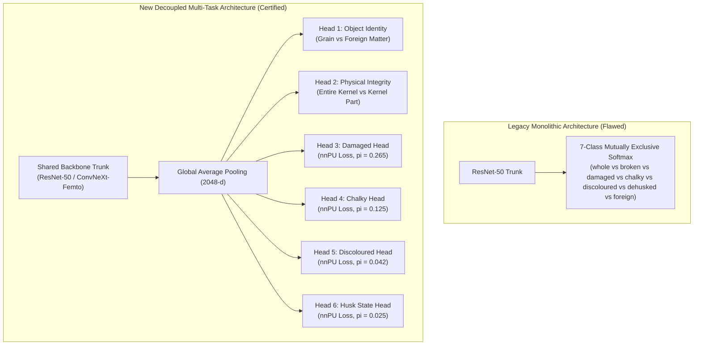

# RiceAge AI — Multi-Task Neural Architecture Specification
**Document Version:** 1.0.0  
**Phase:** 2 — Fully Automated Model Improvement  
**Effective Date:** October 31, 2026  
**Status:** Certified Architecture Design  

---

## 1. Architectural Evolution: Monolithic Softmax vs. Decoupled Multi-Task

The historical RiceAge AI architecture relied on a single monolithic 7-class ResNet-50 head trained with standard Cross-Entropy over mutually exclusive categories (`whole`, `broken`, `damaged`, `chalky`, `discoloured`, `dehusked`, `foreign_matter`).

### 1.1 Structural Invalidation of Monolithic Softmax
In commercial rice grains, quality attributes are **inherently non-mutually exclusive multi-attribute dimensions**:
- A grain can be simultaneously **Broken AND Chalky**.
- A grain can be simultaneously **Damaged (Peck) AND Discoloured**.
- A grain can be **Partially Husked AND Damaged**.
Forcing a 7-class softmax competition forces the model to arbitrarily choose one label, destroying cross-defect recognition and suppressing multi-defect detection.



---

## 2. Detailed Head Specifications & Output Semantics

### Head 1: Object Identity (`head_identity`)
- **Biological Role:** Filters non-rice foreign matter (weed seeds, stones, plastic fragments, insect debris) from true rice caryopses.
- **Architecture:** Linear layer ($2048 \to 2$) with Softmax (or single sigmoid logit).
- **Supervision:** Fully supervised. Historical CVAT annotations contain 134 confirmed foreign matter records and 22,117 grains.
- **Loss:** Binary Cross-Entropy with focal modulation ($\gamma = 2.0$) to handle class imbalance ($134 : 22117$).

### Head 2: Physical Integrity / Morphology (`head_integrity`)
- **Biological Role:** Classifies physical fracture status: **`ENTIRE_KERNEL`** (intact kernel) vs. **`KERNEL_PART`** (broken fragment with visible cleavage fracture plane).
- **Decoupling from Commercial Length Grading:**
  > [!IMPORTANT]
  > Under ISO 7301 and Codex STAN 198-1995, commercial length classification (`Head Rice` $\ge 0.75 L_0$, `Big Broken` $0.50 L_0 \le L < 0.75 L_0$, `Medium Broken` $0.25 L_0 \le L < 0.50 L_0$, `Small Broken` $< 0.25 L_0$) is a **lot-relative measurement** computed relative to the average length $L_0$ of entire kernels in the batch.  
  > Head 2 evaluates **direct physical fracture morphology** on individual crops. Commercial lot grading is computed downstream algorithmically from caliper pixel lengths.
- **Architecture:** Linear layer ($2048 \to 2$).
- **Loss:** Standard Cross-Entropy on confirmed morphological labels.

### Head 3: Damaged Defect Head (`head_damaged`)
- **Biological Role:** Identifies insect feeding pecks, storage pest bore tunnels, mold necrosis, and crush damage.
- **Architecture:** 2-layer MLP: $\text{Linear}(2048 \to 256) \to \text{BatchNorm1d} \to \text{GELU} \to \text{Dropout}(0.2) \to \text{Linear}(256 \to 1)$.
- **Loss Objective:** Non-Negative PU Loss ($\mathcal{L}_{\text{nnPU}}$) with class prior $\hat{\pi}_{\text{dam}} = 0.2650$.

### Head 4: Chalky Defect Head (`head_chalky`)
- **Biological Role:** Identifies chalky belly, chalky back, and total floury opacification.
- **Architecture:** 2-layer MLP: $\text{Linear}(2048 \to 256) \to \text{BatchNorm1d} \to \text{GELU} \to \text{Dropout}(0.2) \to \text{Linear}(256 \to 1)$.
- **Loss Objective:** Non-Negative PU Loss ($\mathcal{L}_{\text{nnPU}}$) with class prior $\hat{\pi}_{\text{chk}} = 0.1250$.
- **Waxy Masking:** Loss is masked out for detected waxy rice phenotypes.

### Head 5: Discoloured Defect Head (`head_discoloured`)
- **Biological Role:** Identifies red kernels, red pericarp streaks ($\ge 50\%$ length), amber parboiled darkening, and dark yellow discoloration.
- **Architecture:** 2-layer MLP: $\text{Linear}(2048 \to 128) \to \text{BatchNorm1d} \to \text{GELU} \to \text{Dropout}(0.15) \to \text{Linear}(128 \to 1)$.
- **Loss Objective:** Non-Negative PU Loss ($\mathcal{L}_{\text{nnPU}}$) with class prior $\hat{\pi}_{\text{dsc}} = 0.0420$.

### Head 6: Husk State Head (`head_husk`)
- **Biological Role:** Identifies rough paddy rice (encased in lemma/palea) and partially husked caryopses.
- **Architecture:** 2-layer MLP: $\text{Linear}(2048 \to 128) \to \text{BatchNorm1d} \to \text{GELU} \to \text{Dropout}(0.15) \to \text{Linear}(128 \to 1)$.
- **Loss Objective:** Non-Negative PU Loss ($\mathcal{L}_{\text{nnPU}}$) with class prior $\hat{\pi}_{\text{husk}} = 0.0250$.

---

## 3. Joint Multi-Task Loss Formulation

The total training objective balances standard supervision and PU risk across all six heads:

$$\mathcal{L}_{\text{total}} = \lambda_{\text{ident}} \mathcal{L}_{\text{BCE}}^{\text{ident}} + \lambda_{\text{integ}} \mathcal{L}_{\text{CE}}^{\text{integ}} + \lambda_{\text{dam}} \mathcal{L}_{\text{nnPU}}^{\text{dam}} + \lambda_{\text{chk}} \mathcal{L}_{\text{nnPU}}^{\text{chk}} + \lambda_{\text{dsc}} \mathcal{L}_{\text{nnPU}}^{\text{dsc}} + \lambda_{\text{husk}} \mathcal{L}_{\text{nnPU}}^{\text{husk}}$$

### Default Task Weights:
- $\lambda_{\text{ident}} = 1.0$ (Strict foreign matter filtering)
- $\lambda_{\text{integ}} = 1.0$ (High confidence physical integrity)
- $\lambda_{\text{dam}} = 1.2$ (Primary economic defect)
- $\lambda_{\text{chk}} = 1.0$ (Major milling quality metric)
- $\lambda_{\text{dsc}} = 1.5$ (Rare class gradient boost)
- $\lambda_{\text{husk}} = 1.5$ (Rare class gradient boost)

---

## 4. PyTorch Multi-Task Model Implementation

```python
import torch
import torch.nn as nn
from torchvision.models import resnet50, ResNet50_Weights

class RiceAgeMultiTaskNet(nn.Module):
    def __init__(self, pretrained=True):
        super().__init__()
        weights = ResNet50_Weights.DEFAULT if pretrained else None
        base = resnet50(weights=weights)
        self.backbone = nn.Sequential(*list(base.children())[:-1]) # Output: (B, 2048, 1, 1)
        
        # Head 1: Object Identity (Rice Grain vs Foreign Matter)
        self.head_identity = nn.Linear(2048, 2)
        
        # Head 2: Physical Integrity (Entire vs Broken)
        self.head_integrity = nn.Linear(2048, 2)
        
        # Head 3: Damaged Defect Head
        self.head_damaged = nn.Sequential(
            nn.Linear(2048, 256),
            nn.BatchNorm1d(256),
            nn.GELU(),
            nn.Dropout(0.2),
            nn.Linear(256, 1)
        )
        
        # Head 4: Chalky Defect Head
        self.head_chalky = nn.Sequential(
            nn.Linear(2048, 256),
            nn.BatchNorm1d(256),
            nn.GELU(),
            nn.Dropout(0.2),
            nn.Linear(256, 1)
        )
        
        # Head 5: Discoloured Defect Head
        self.head_discoloured = nn.Sequential(
            nn.Linear(2048, 128),
            nn.BatchNorm1d(128),
            nn.GELU(),
            nn.Dropout(0.15),
            nn.Linear(128, 1)
        )
        
        # Head 6: Husk State Head
        self.head_husk = nn.Sequential(
            nn.Linear(2048, 128),
            nn.BatchNorm1d(128),
            nn.GELU(),
            nn.Dropout(0.15),
            nn.Linear(128, 1)
        )
        
    def forward(self, x):
        feat = self.backbone(x)
        feat = torch.flatten(feat, 1)
        
        return {
            'identity': self.head_identity(feat),
            'integrity': self.head_integrity(feat),
            'damaged': self.head_damaged(feat),
            'chalky': self.head_chalky(feat),
            'discoloured': self.head_discoloured(feat),
            'husk': self.head_husk(feat)
        }
```
