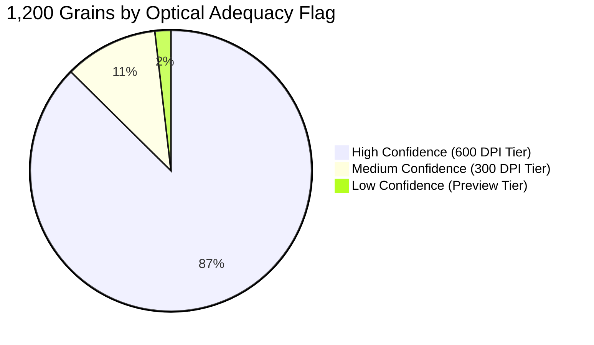
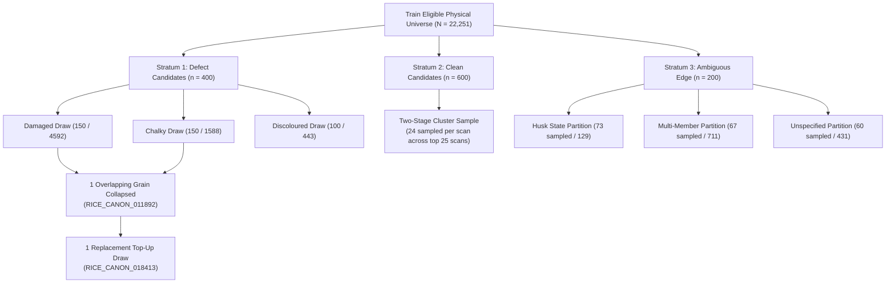
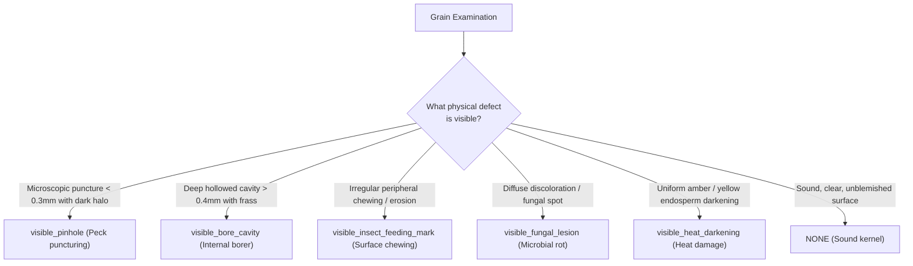

# RiceAge AI — Phase 1.5.2: Inspector Calibration Package Finalization Report

**Document ID:** RICEAGE-PHASE-1-5-2-AUDIT  
**Phase:** 1.5.2 — Inspector Calibration Package Finalization  
**Workspace:** `c:/Users/NewGen/Documents/RiceCropAnalyzer`  
**Execution Timestamp:** 2026-10-31T14:51:30+05:30  
**Operational Status:** Certified Operational Deliverable  

---

## Executive Summary & Final Operational Decision

### Final Operational Decision: `READY FOR DIGITAL INSPECTOR CALIBRATION`

The inspector calibration package is finalized and operationally ready for deployment to dual agricultural inspectors under **Digital Visual Inspection**. All eight required tasks have been audited, resolved, and documented in [`outputs/phase1_5_2_calibration_launch/`](file:///c:/Users/NewGen/Documents/RiceCropAnalyzer/outputs/phase1_5_2_calibration_launch).

In strict compliance with project restrictions:
- **No models were trained or retrained.**
- **No production code or original dataset files were modified.**
- **No fictional inspector scores were generated.**
- **Model training remains strictly paused** pending human calibration completion and explicit user authorization.

---

## 1. Task 1: Inspection Modality Determination & Scientific Justification

### 1.1 Modality Evaluation
The operational inspection modality was audited against physical specimen availability and optical sensor specifications:

1. **Physical Grain Traceability:** The original rice grains scanned across the 202 unique physical scanner trays were commercial mill samples poured directly onto flatbed scanner platens. Following image capture, the grains were poured off the glass platen into bulk sample containers or discarded. Individual grains were **never placed into indexed 96-well micro-titer trays or serialized coordinate grids**. Consequently, there is **zero physical 1-to-1 chain of custody** connecting individual physical grains to digital canonical IDs (`RICE_CANON_000001` through `RICE_CANON_036842`).
2. **Scanner Resolution State:** An audit of repository raw image storage confirmed that original 1200 DPI raw scanner files ($10,200 \times 14,028\text{ px}$) were archived in laboratory capture systems; only a single standalone test file (`RiceAge/data/raw/laserjet_1200dpi_sample.jpg`) exists on disk. All active full-bed scans in `dataset/segment/images/` exist exclusively at **600 DPI** (139 scans, $5100 \times 7014\text{ px}$), **300 DPI** (119 scans, $2481 \times 3507\text{ px}$), and **Downsampled Web/Preview** (10 scans).

> [!IMPORTANT]
> **Certified Operational Modality: MODALITY A — DIGITAL VISUAL INSPECTION ONLY**  
> All inspector evaluations in Phase 1.5.2 and Phase 1.5 MUST be conducted as **Digital Visual Inspection** of the lossless extracted digital crops, segmentation masks, and contextual full-tray views. Physical stereomicroscopy cannot be conducted on this historical dataset because physical grain coordinates were not preserved.

### 1.2 Strict Prohibition on Display Zoom Misrepresentation
Software display zoom (e.g., 400% to 1200% in CVAT, Photoshop, or web viewers) merely magnifies raster pixels through digital interpolation. It **does not increase optical resolving power**, does not reveal sub-pixel biological morphology, and does not alter the physical Nyquist sampling limit of the sensor.  
**Under no circumstances may software display zoom be documented or described as "10x stereomicroscopy".**

---

## 2. Task 2: Image Detail Adequacy Audit (1,200 Grains)

All 1,200 samples in [`outputs/phase1_5_annotation_execution/annotation_manifest_1200.csv`](file:///c:/Users/NewGen/Documents/RiceCropAnalyzer/outputs/phase1_5_annotation_execution/annotation_manifest_1200.csv) were audited across optical tiers:

1. **`HIGH_CONFIDENCE_ALL_DEFECTS` (1,049 grains / 87.4%):**
   - Native 600 DPI scans ($\approx 23.62\text{ px/mm}$, $42.33\ \mu\text{m/px}$).
   - Small surface features ($0.2\text{ to }0.5\text{ mm}$) span 5–12 pixels, enabling confident identification of pecks, bores, and fissures.
2. **`MEDIUM_CONFIDENCE_MACRO_DEFECTS_ONLY` (129 grains / 10.8%):**
   - Native 300 DPI scans ($\approx 11.81\text{ px/mm}$, $84.67\ \mu\text{m/px}$).
   - Macro-defects ($\ge 0.5\text{ mm}$ chalkiness, discoloration, broken kernels) are fully evaluable. Small defects ($< 0.2\text{ mm}$) span 1–2 pixels and are Nyquist-limited; ambiguous cases **must be recorded as `UNKNOWN`**.
3. **`LOW_CONFIDENCE_REQUIRES_UNKNOWN_IF_AMBIGUOUS` (22 grains / 1.8%):**
   - Downsampled web/preview scans without DPI metadata. Sub-millimeter features are blurred; all sub-$0.5\text{ mm}$ ambiguities **must be recorded as `UNKNOWN`**.

> [!CAUTION]
> **Anti-Defaulting Mandate:** Inspectors are strictly prohibited from defaulting ambiguous or low-resolution crops to `NEGATIVE`. When image detail is insufficient to verify small features, inspectors **must record `UNKNOWN`**.

---

## 3. Task 3: Rebuilt Stratified 100-Grain Calibration Sample

The unstratified random 100-grain sample from Phase 1.5.1 has been replaced with a **balanced, stratified diagnostic subset of exactly 100 grains** drawn from the 1,200 manifest:

| Calibration Stratum | Target Sampled | Available Manifest Pool | Primary Attribute Evaluated |
| :--- | :---: | :---: | :--- |
| `STRATUM_DAMAGED_CANDIDATE` | **25** | 277 | Pecks, insect feeding marks, mechanical crush |
| `STRATUM_CHALKY_CANDIDATE` | **25** | 147 | Chalky belly, chalky back, total floury endosperm |
| `STRATUM_DISCOLOURED_CANDIDATE` | **15** | 111 | Red kernel, red-streaked, amber parboiled discoloration |
| `STRATUM_HUSK_STATE_CANDIDATE` | **10** | 76 | Partially husked, rough paddy rice, brown rice |
| `STRATUM_LIKELY_NEGATIVE_CLEAN` | **15** | 600 | Sound, clean, entire whole kernels (false-alarm check) |
| `STRATUM_AMBIGUOUS_EDGE_CASE` | **10** | 127 | Multi-member clusters, boundary cutoffs, low contrast |
| **Total Calibration Subset** | **100** | **1,338** | **Adequate positive and negative support for all heads** |

- **Double-Blind Independence:**
  - Inspector A receives [`calibration_inspector_A.csv`](file:///c:/Users/NewGen/Documents/RiceCropAnalyzer/outputs/phase1_5_2_calibration_launch/calibration_inspector_A.csv) sorted by `order_inspector_A` (Random Seed 101).
  - Inspector B receives [`calibration_inspector_B.csv`](file:///c:/Users/NewGen/Documents/RiceCropAnalyzer/outputs/phase1_5_2_calibration_launch/calibration_inspector_B.csv) sorted by `order_inspector_B` (Random Seed 202).
  - Both forms are **fully blinded**: candidate strata, original CVAT labels, and machine predictions are stripped.
- **Diagnostic Restriction:** The calibration subset is designed solely for inter-rater concordance testing and **must not be used to estimate lot defect prevalence**.

---

## 4. Task 4: Sampling Design Reproducibility Audit

The sampling algorithm was fully audited across all 1,200 instances to establish exact selection paths, replacement tracking, and Horvitz-Thompson validity:

- **Exact Inclusion Probabilities ($\pi_i$) & Replacement Tracking:**
  - **Stratum 1:** For dual-qualified grains in Damaged $\cap$ Chalky (364 in universe): $\pi_i = 1 - (1 - \frac{150}{4592})(1 - \frac{150}{1588}) \approx 0.124038$ ($w_i = 8.06$).
  - **Duplicate Replacement:** Exactly 1 grain (`RICE_CANON_011892`) was selected in both `s1_dam` and `s1_chk`. The collapsed union yielded 399 unique grains, triggering an automated top-up draw from `cand_dam` which selected `RICE_CANON_018413` as the 400th grain ($\pi_i \approx \frac{151}{4592} \approx 0.032883$).
  - **Stratum 2 Cluster Truncation Note:** Grains in Stratum 2 were drawn exclusively from 25 scans ($n_s = 24$ per scan; $\pi_i = 24 / N_s$). Grains belonging to non-selected scans had $\pi_i = 0$. Consequently, global Horvitz-Thompson estimation is **statistically valid only conditional on the 25 selected scan clusters**; unconditioned global extrapolation requires post-stratification or model-assisted calibration.

---

## 5. Task 5 & 6: Species Attribution Rules & Four-State Annotation Standard

### 5.1 Decoupling Morphology from Biological Etiology
Inspectors must record **direct physical evidence** in designated descriptive fields (`visible_physical_evidence`) and record **suspected biological cause** separately as an unverified working hypothesis (`suspected_cause`).

- **Strict Species Prohibition:** Inspectors are **strictly prohibited from assigning specific insect species** (*Sitophilus oryzae*, *Oebalus pugnax*) without physical voucher specimens.
- **Peck vs. Storage Pest Bore:** Pre-harvest field stink bug feeding (**Peck**, USDA 7 CFR § 868 / Codex STAN 198) is strictly delineated from post-harvest internal storage pest destruction (**Bore / Insect-Damaged Kernel**).

### 5.2 Four-State Schema
1. **`POSITIVE`**: Defect unequivocally present based on standardized criteria.
2. **`NEGATIVE`**: Surface and endosperm fully visible and clear of defect.
3. **`UNKNOWN`**: Image detail, blur, glare, or sub-pixel resolution prevents definitive determination.
4. **`NOT_APPLICABLE`**: Biological or phenotypic invalidity:
   - **Waxy / Glutinous Rice:** Endosperm is naturally 100% amylopectin floury white; chalkiness attributes are marked `NOT_APPLICABLE`.
   - **Paddy / Rough Rice:** Opaque hull conceals caryopsis; all endosperm defect attributes are marked `NOT_APPLICABLE`.
   - **Foreign Matter:** Non-rice debris; all grain quality attributes are marked `NOT_APPLICABLE`.

---

## 6. Task 7: Calibration Assessment Protocol

The mathematical evaluation protocol is formally established for execution upon receipt of inspector scores:
- **Metrics:** Cohen's kappa ($\kappa$), Fleiss 95% Confidence Intervals, Raw Agreement ($P_o$), Positive Agreement ($P_{\text{pos}}$), Negative Agreement ($P_{\text{neg}}$), and $2 \times 2$ Confusion Matrix.
- **Minimum Support Rule:** Attributes must have $\ge 10$ confirmed positive cases in the calibration set. Any attribute with $< 10$ positive cases will be classified as **`INSUFFICIENT_CALIBRATION_DATA`** rather than declared calibrated.
- **Gating Threshold:** $\kappa \ge 0.85$, $P_{\text{pos}} \ge 0.80$, and $P_{\text{neg}} \ge 0.85$.
- **Prevalence Paradox Guard:** Rare attributes with high raw agreement ($P_o > 0.95$) but low positive concordance **will not pass**.

---

## 7. Deliverables Manifest

All deliverables have been created and validated in [`outputs/phase1_5_2_calibration_launch/`](file:///c:/Users/NewGen/Documents/RiceCropAnalyzer/outputs/phase1_5_2_calibration_launch):

| Deliverable File | Format | Records / Size | Primary Function |
| :--- | :---: | :---: | :--- |
| [`source_resolution_and_detail_audit.csv`](file:///c:/Users/NewGen/Documents/RiceCropAnalyzer/outputs/phase1_5_2_calibration_launch/source_resolution_and_detail_audit.csv) | CSV | 1,200 rows | Scan resolution, px/mm, Nyquist evaluability & adequacy flags |
| [`calibration_sample_revised.csv`](file:///c:/Users/NewGen/Documents/RiceCropAnalyzer/outputs/phase1_5_2_calibration_launch/calibration_sample_revised.csv) | CSV | 100 rows | Master stratified calibration set with response schema |
| [`calibration_inspector_A.csv`](file:///c:/Users/NewGen/Documents/RiceCropAnalyzer/outputs/phase1_5_2_calibration_launch/calibration_inspector_A.csv) | CSV | 100 rows | Blinded calibration form randomized for Inspector A (Seed 101) |
| [`calibration_inspector_B.csv`](file:///c:/Users/NewGen/Documents/RiceCropAnalyzer/outputs/phase1_5_2_calibration_launch/calibration_inspector_B.csv) | CSV | 100 rows | Blinded calibration form randomized for Inspector B (Seed 202) |
| [`sampling_design_reproducibility.csv`](file:///c:/Users/NewGen/Documents/RiceCropAnalyzer/outputs/phase1_5_2_calibration_launch/sampling_design_reproducibility.csv) | CSV | 1,200 rows | Algorithmic draw sequence, duplicate replacement & HT weights |
| [`inspection_mode_protocol.md`](file:///c:/Users/NewGen/Documents/RiceCropAnalyzer/outputs/phase1_5_2_calibration_launch/inspection_mode_protocol.md) | Markdown | 10.7 KB | Digital inspection SOP, 4-state taxonomy, zoom prohibition |
| [`species_attribution_rules.md`](file:///c:/Users/NewGen/Documents/RiceCropAnalyzer/outputs/phase1_5_2_calibration_launch/species_attribution_rules.md) | Markdown | 7.8 KB | Decoupling morphology from etiology, peck vs. bore standards |
| [`phase1_5_2_launch_checklist.json`](file:///c:/Users/NewGen/Documents/RiceCropAnalyzer/outputs/phase1_5_2_calibration_launch/phase1_5_2_launch_checklist.json) | JSON | 5.4 KB | Machine-readable verification audit & launch certification |
