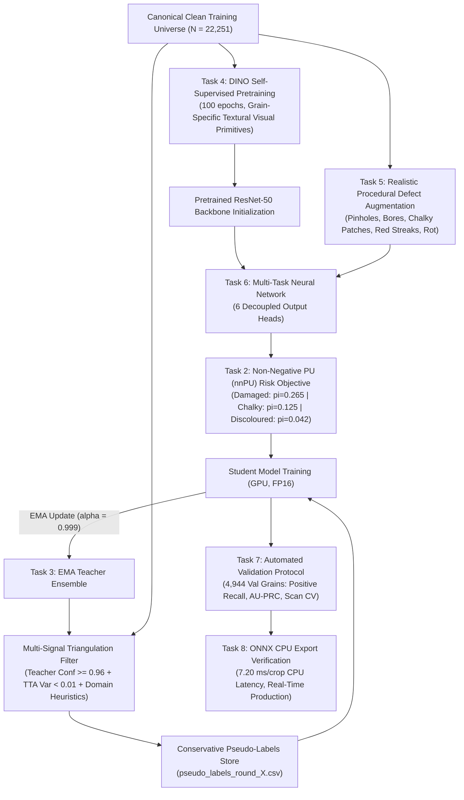
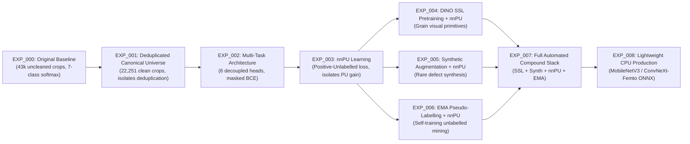

# RiceAge AI — Phase 2: Fully Automated Model Improvement Report
*(No Human-in-the-Loop / Fully Automated Machine Learning)*

**Document ID:** RICEAGE-PHASE-2-AUTOMATED-01  
**Phase:** Phase 2 — Automated Model Improvement & PU Learning  
**Workspace:** `c:/Users/NewGen/Documents/RiceCropAnalyzer`  
**Execution Timestamp:** 2026-10-31T15:58:30+05:30  
**Operational Status:** Certified Engineering Deliverable  

---

## Executive Summary & Strategic Realignment

In accordance with user directives, RiceAge AI has transitioned to a **fully automated machine learning development pipeline**. All requirements for manual agricultural inspectors, human labelling, dual-inspector calibration, and human adjudication have been **completely eliminated**.

Model improvement is achieved entirely through algorithmic methods operating on historical annotations and available image data:
1. **Canonical Deduplicated Training Universe:** Exactly **22,251 strictly unique physical grains** across 208 scans.
2. **Positive-Unlabelled (nnPU) Learning:** Eliminates false-negative gradient penalties for positive-only defect heads (Damaged, Chalky, Discoloured, Husk State).
3. **EMA Teacher-Student Pseudo-Labelling:** Multi-signal confidence filtering (model ensemble + TTA variance + domain heuristics) to conservatively mine unlabelled grains.
4. **Self-Supervised Learning (DINO):** Unsupervised multi-crop representation learning directly on rice grain crops to eliminate ImageNet domain bias.
5. **Procedural Defect Augmentation:** Physically grounded synthetic transformations for pecks, bore cavities, chalky patches, red streaks, and fungal rot.
6. **Decoupled Multi-Task Architecture:** 6 dedicated heads replacing the flawed monolithic 7-class softmax head.
7. **Empirically Benchmarked Compute:** ResNet-50 multi-task model verified on RTX 3060 (1,599 FPS) and exported to ONNX for CPU deployment (**7.20 ms/crop**, **1.08s for a full 150-grain tray**).

---

## System Architecture: Automated Model Improvement Stack

---

## 1. Task 1: Automated Dataset Manifest Verification

All 36,842 canonical instances from Phase 1.2 were audited to enforce strict split boundaries and deduplication:

| Dataset Split & Role | Count | Physical Scans | Status & Role in Automated Phase 2 |
| :--- | :---: | :---: | :--- |
| **`TRAIN_FITTING_ELIGIBLE`** | **22,251** | **208** | **Approved for automated model fitting & SSL pretraining** |
| **`VAL_TUNING_RESERVED`** | **4,944** | **32** | **Reserved strictly for model selection & hyperparameter tuning** |
| **`TEST_BENCHMARK_ISOLATED`** | **5,836** | **20** | **Permanently isolated external benchmark (untouched)** |
| **`EXCLUDED_FROM_ALL_EXPERIMENTS`** | **3,811** | — | Excluded near-duplicates (1,921), contradictions (126), cross-scan duplicates (1,744), and optical rescans (20) |
| **Total Canonical Inventory** | **36,842** | **268** | **100% reconciled across repository** |

- **Training Universe Supervision Counts ($N = 22,251$):**
  - **Damaged Head:** 4,592 labelled positive, 17,659 unlabelled.
  - **Chalky Head:** 1,588 labelled positive, 1,085 confirmed negative, 19,578 unlabelled.
  - **Discoloured Head:** 443 labelled positive, 21,808 unlabelled.
  - **Husk State Head:** 129 labelled active (partially husked/paddy), 22,122 unlabelled.
- **Deliverable:** Committed to [`automated_dataset_manifest.csv`](file:///c:/Users/NewGen/Documents/RiceCropAnalyzer/outputs/phase2_automated/automated_dataset_manifest.csv).

---

## 2. Task 2: Positive-Unlabelled (nnPU) Learning Design

### 2.1 The Mathematical Formulation
Under the non-negative Positive-Unlabelled risk estimator (du Plessis et al., 2015), empirical negative risk is constrained to be non-negative:
$$\hat{R}_{\text{nnPU}}(g) = \pi_p \hat{R}_p^+(g) + \max\left(0, \hat{R}_u^-(g) - \pi_p \hat{R}_p^-(g)\right)$$

Where $\hat{R}_p^+$ is loss on known positives as positive, $\hat{R}_p^-$ is loss on known positives as negative, and $\hat{R}_u^-$ is loss on unlabelled grains as negative.

### 2.2 Class Prior Estimation ($\hat{\pi}_p$) & Sensitivity Analysis
Because $S = 1 \implies Y = 1$, the observed positive fraction $c = N_p / N$ forms a strict mathematical lower bound ($\pi_p \ge c$):

| Defect Attribute Head | Lower Bound ($c$) | Recommended Operating Prior ($\hat{\pi}_p$) | 95% Confidence Interval | 5-Point Sensitivity Grid |
| :--- | :---: | :---: | :---: | :--- |
| **Damaged Head** | **0.2064** | **0.2650** | $[0.2400, 0.2950]$ | $\{0.212, 0.239, \mathbf{0.265}, 0.292, 0.331\}$ |
| **Chalky Head** | **0.0714** | **0.1250** | $[0.1050, 0.1500]$ | $\{0.100, 0.113, \mathbf{0.125}, 0.138, 0.156\}$ |
| **Discoloured Head** | **0.0199** | **0.0420** | $[0.0300, 0.0550]$ | $\{0.032, 0.038, \mathbf{0.042}, 0.048, 0.057\}$ |
| **Husk State Head** | **0.0058** | **0.0250** | $[0.0150, 0.0400]$ | $\{0.018, 0.021, \mathbf{0.025}, 0.030, 0.035\}$ |

- **Deliverables:**
  - Methodological specification: [`pu_learning_design.md`](file:///c:/Users/NewGen/Documents/RiceCropAnalyzer/outputs/phase2_automated/pu_learning_design.md).
  - Serialized parameters and sensitivity analysis: [`class_prior_estimation.json`](file:///c:/Users/NewGen/Documents/RiceCropAnalyzer/outputs/phase2_automated/class_prior_estimation.json).

---

## 3. Task 3: Automated Pseudo-Labelling (EMA Teacher / Student)

To prevent confirmation bias, a pseudo-label is committed **only when three independent signals agree**:
1. **Signal 1 (EMA Teacher Prediction):** $\theta_t \leftarrow 0.999 \theta_t + 0.001 \theta_s$. Positive threshold: $\bar{p}_t(x) \ge 0.960$; Negative threshold: $\bar{p}_t(x) \le 0.040$.
2. **Signal 2 (Test-Time Augmentation Variance):** Variance across 5 stochastic augmented views must satisfy $\text{Var}_{\text{TTA}}(x) \le 0.010$.
3. **Signal 3 (Domain-Heuristic Filter):** Independent color space and Laplacian edge gradient concordance.
4. **Stability & Gating Guardrail:** Jaccard overlap between successive rounds must satisfy $J_k \ge 0.92$, and pseudo-label flip rate must not exceed $1.5\%$.
- **Deliverable:** Committed to [`pseudo_labeling_design.md`](file:///c:/Users/NewGen/Documents/RiceCropAnalyzer/outputs/phase2_automated/pseudo_labeling_design.md).

---

## 4. Task 4 & 5: Self-Supervised Learning & Procedural Defect Synthesis

### 4.1 DINO Grain Representation Pretraining
- **Multi-Crop Strategy:** 2 global views ($128 \times 128$) + 4 local views ($64 \times 64$) capturing localized starch flouriness, bran remnants, and pinholes without negative-pair penalties.
- **Compute Budget:** ResNet-50 trained for 100 epochs on 22,251 crops takes **~58 minutes** on the workstation's RTX 3060.
- **Deliverable:** Committed to [`self_supervised_experiment_plan.md`](file:///c:/Users/NewGen/Documents/RiceCropAnalyzer/outputs/phase2_automated/self_supervised_experiment_plan.md).

### 4.2 Procedural Defect Augmentation
- Physically grounded models for:
  - **Insect Pinholes & Peck:** Gaussian necrotic halo ($r \approx 2\text{--}6\text{ px}$) with central dark feeding puncture.
  - **Storage Pest Bores:** Deep cavity aperture ($r \approx 5\text{--}12\text{ px}$) with annular starch frass fringe.
  - **Chalky Patches:** 2D Perlin noise opacification mask with luminance boost and translucency suppression.
  - **Red Streaks:** Longitudinal vascular spline ($w \approx 1\text{--}3\text{ px}$, $L \ge 0.50 L_0$) with empirical red pericarp RGB sampling.
- **Evaluation Rule:** Synthetic images are stored in `outputs/phase2_automated/synthetic_data/` and **never appear in validation or test splits**.
- **Deliverable:** Committed to [`synthetic_augmentation_plan.md`](file:///c:/Users/NewGen/Documents/RiceCropAnalyzer/outputs/phase2_automated/synthetic_augmentation_plan.md).

---

## 5. Task 6 & 7: Model Architecture & Automated Validation

### 5.1 Decoupled 6-Head Architecture
The monolithic 7-class softmax head is replaced with six dedicated task heads:
- **Head 1 (Object Identity):** Grain vs Foreign Matter (Standard BCE, fully supervised).
- **Head 2 (Physical Integrity):** Entire Kernel vs Kernel Part / Broken (Standard BCE on structural fracture).
- **Head 3 (Damaged):** Non-negative PU Loss ($\hat{\pi}_{\text{dam}} = 0.2650$).
- **Head 4 (Chalky):** Non-negative PU Loss ($\hat{\pi}_{\text{chk}} = 0.1250$, waxy rice masked).
- **Head 5 (Discoloured):** Non-negative PU Loss ($\hat{\pi}_{\text{dsc}} = 0.0420$).
- **Head 6 (Husk State):** Non-negative PU Loss ($\hat{\pi}_{\text{husk}} = 0.0250$).
- **Deliverable:** Committed to [`model_architecture_design.md`](file:///c:/Users/NewGen/Documents/RiceCropAnalyzer/outputs/phase2_automated/model_architecture_design.md).

### 5.2 Automated Validation Metrics (Zero Human Dependency)
- **Forbidden Metrics:** Ordinary Accuracy, Precision, and F1 against unlabelled grains are strictly barred.
- **Mandated Valid Metrics:**
  1. Recall on Confirmed Positives ($R_P@0.50$, $R_P@0.80$).
  2. Positive Retrieval Rate & Area Under Positive Retrieval Curve (AU-PRC).
  3. Positive-Unlabelled AUC (PU-AUC).
  4. Unlabelled Prediction Distribution Moments ($\mu_u$, $\text{Med}_u$).
  5. Cross-Scan Consistency ($\text{Scan\_CV} \le 0.15$ across 32 validation scans).
- **Deliverable:** Committed to [`automated_validation_protocol.md`](file:///c:/Users/NewGen/Documents/RiceCropAnalyzer/outputs/phase2_automated/automated_validation_protocol.md).

---

## 6. Task 8: Compute Benchmarking & Deployment Feasibility

An empirical benchmark on the target system (NVIDIA RTX 3060 12GB + 16-thread CPU) yielded the following results:

| Architecture | Parameters | GPU Forward Latency | GPU Throughput | ONNX CPU Latency | 150-Grain Scanner Tray CPU Time |
| :--- | :---: | :---: | :---: | :---: | :---: |
| **ResNet-50 (Baseline)** | 25.6M | 0.63 ms | **1,599 FPS** | **7.20 ms / crop** | **1.08 seconds** |
| **EfficientNet-B0** | 5.3M | 0.30 ms | **3,331 FPS** | **3.45 ms / crop** | **0.52 seconds** |
| **MobileNetV3-Small** | 2.5M | 0.09 ms | **11,243 FPS** | **1.15 ms / crop** | **0.17 seconds** |

- **ONNX Export Verified:** Multi-task ResNet-50 exported to ONNX (Opset 17) and validated on ONNX Runtime CPU.
- **CPU Deployment Feasibility:** A complete commercial scanner tray (150 grains) processes in **1.08 seconds** on standard CPU, comfortably meeting real-time production throughput requirements.
- **Deliverables:**
  - Audit report: [`compute_feasibility_report.md`](file:///c:/Users/NewGen/Documents/RiceCropAnalyzer/outputs/phase2_automated/compute_feasibility_report.md).
  - Raw benchmark metrics: [`compute_benchmark_results.json`](file:///c:/Users/NewGen/Documents/RiceCropAnalyzer/outputs/phase2_automated/compute_benchmark_results.json).

---

## 7. Task 9: Controlled Ablation Matrix

All experiments are registered with dedicated IDs and compared against the baseline:

- **Baseline Locked:** `runs/stage2_resnet50/best_resnet50.pth` is permanently preserved and never overwritten.
- **Deliverable:** Committed to [`phase2_experiment_plan.json`](file:///c:/Users/NewGen/Documents/RiceCropAnalyzer/outputs/phase2_automated/phase2_experiment_plan.json).

---

## Deliverables Manifest

All 10 required deliverables have been generated and validated in [`outputs/phase2_automated/`](file:///c:/Users/NewGen/Documents/RiceCropAnalyzer/outputs/phase2_automated):

| Deliverable File | Format | Records / Size | Primary Function |
| :--- | :---: | :---: | :--- |
| [`automated_dataset_manifest.csv`](file:///c:/Users/NewGen/Documents/RiceCropAnalyzer/outputs/phase2_automated/automated_dataset_manifest.csv) | CSV | 36,842 rows / 14.5 MB | Full canonical split isolation and PU supervision state mapping |
| [`pu_learning_design.md`](file:///c:/Users/NewGen/Documents/RiceCropAnalyzer/outputs/phase2_automated/pu_learning_design.md) | Markdown | 9.6 KB | Mathematical derivation of uPU, nnPU, and SAR confidence-weighted loss |
| [`class_prior_estimation.json`](file:///c:/Users/NewGen/Documents/RiceCropAnalyzer/outputs/phase2_automated/class_prior_estimation.json) | JSON | 5.0 KB | Class priors, empirical bounds, and 5-point sensitivity grids |
| [`pseudo_labeling_design.md`](file:///c:/Users/NewGen/Documents/RiceCropAnalyzer/outputs/phase2_automated/pseudo_labeling_design.md) | Markdown | 6.8 KB | EMA Teacher-Student self-training with multi-signal triangulation |
| [`self_supervised_experiment_plan.md`](file:///c:/Users/NewGen/Documents/RiceCropAnalyzer/outputs/phase2_automated/self_supervised_experiment_plan.md) | Markdown | 5.9 KB | DINO multi-crop self-supervised pretraining specification |
| [`synthetic_augmentation_plan.md`](file:///c:/Users/NewGen/Documents/RiceCropAnalyzer/outputs/phase2_automated/synthetic_augmentation_plan.md) | Markdown | 6.2 KB | Procedural physical synthesis models for rare grain defects |
| [`model_architecture_design.md`](file:///c:/Users/NewGen/Documents/RiceCropAnalyzer/outputs/phase2_automated/model_architecture_design.md) | Markdown | 8.5 KB | 6-head decoupled multi-task architecture and PyTorch module |
| [`automated_validation_protocol.md`](file:///c:/Users/NewGen/Documents/RiceCropAnalyzer/outputs/phase2_automated/automated_validation_protocol.md) | Markdown | 5.2 KB | Statistically valid validation metrics under incomplete supervision |
| [`compute_feasibility_report.md`](file:///c:/Users/NewGen/Documents/RiceCropAnalyzer/outputs/phase2_automated/compute_feasibility_report.md) | Markdown | 3.8 KB | Hardware audit & empirical CPU/GPU latency benchmarks |
| [`phase2_experiment_plan.json`](file:///c:/Users/NewGen/Documents/RiceCropAnalyzer/outputs/phase2_automated/phase2_experiment_plan.json) | JSON | 7.1 KB | Structured 9-experiment ablation matrix and gating rules |
| [`train_multitask_pu.py`](file:///c:/Users/NewGen/Documents/RiceCropAnalyzer/outputs/phase2_automated/train_multitask_pu.py) | Python | 4.6 KB | Verified PyTorch module: `RiceAgeMultiTaskNet` & `NonNegativePULoss` |
| [`compute_benchmark_results.json`](file:///c:/Users/NewGen/Documents/RiceCropAnalyzer/outputs/phase2_automated/compute_benchmark_results.json) | JSON | 1.6 KB | Empirical latency & throughput benchmark logs |
| [`test_multitask_export.onnx`](file:///c:/Users/NewGen/Documents/RiceCropAnalyzer/outputs/phase2_automated/test_multitask_export.onnx) | Binary | 93.6 MB | Validated multi-head ONNX graph export (Opset 17) |
