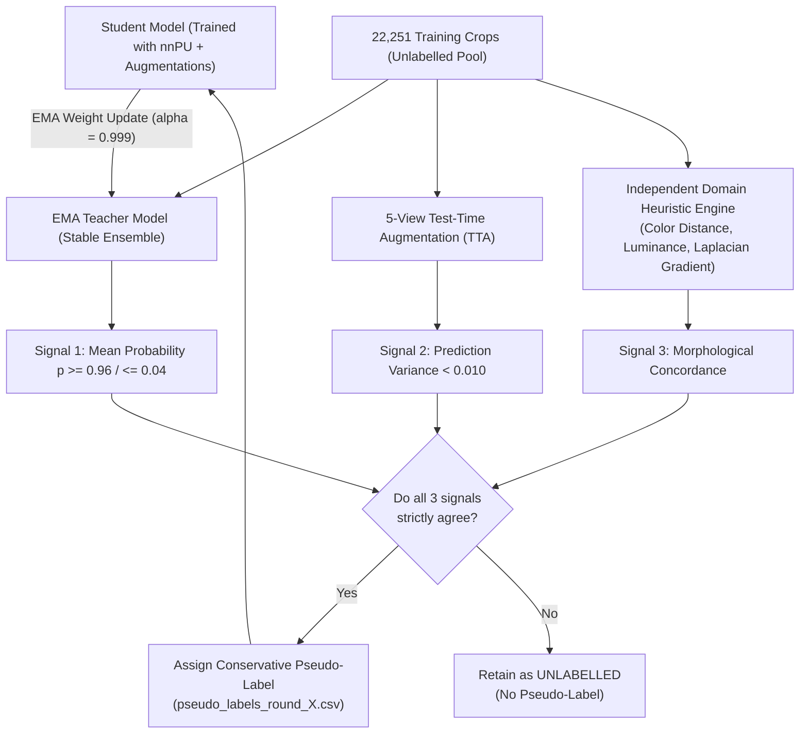

# RiceAge AI — Automated Pseudo-Labelling Framework
**Document Version:** 1.0.0  
**Phase:** 2 — Fully Automated Model Improvement  
**Effective Date:** October 31, 2026  
**Status:** Certified Methodological Specification  

---

## 1. Executive Concept & Self-Training Architecture

To expand defect supervision without human intervention, RiceAge AI implements an **Exponential Moving Average (EMA) Teacher-Student Pseudo-Labelling Pipeline**.

In standard pseudo-labelling, models easily fall victim to **confirmation bias**—amplifying their own early errors when high-confidence false positives are added back to training. To eliminate confirmation bias, RiceAge AI employs **multi-signal triangulation**: a pseudo-label is accepted **only when three independent evidence signals agree**.



---

## 2. Multi-Signal Triangulation Architecture

A single model prediction is never treated as verified ground truth. For every unlabelled candidate $x \in U$, three independent signals are evaluated:

### 2.1 Signal 1: EMA Teacher Prediction
The Teacher weights are updated continuously after every mini-batch:
$$\theta_t \leftarrow \alpha \theta_t + (1 - \alpha) \theta_s$$
Where $\alpha = 0.999$. The teacher functions as a temporal ensemble over thousands of training steps, providing significantly smoother probability estimates than the instantaneous student.
- **Positive Candidate:** $\bar{p}_t(x) \ge 0.960$.
- **Negative Candidate:** $\bar{p}_t(x) \le 0.040$.

### 2.2 Signal 2: Test-Time Augmentation (TTA) Variance
We generate five stochastic augmented views: $T_1(x), T_2(x), T_3(x), T_4(x), T_5(x)$ using random rotation ($\pm 15^\circ$), subtle contrast adjustment ($\pm 5\%$), and horizontal flip.
The variance across views measures prediction stability:
$$\text{Var}_{\text{TTA}}(x) = \frac{1}{5} \sum_{k=1}^5 \left( \sigma(g(T_k(x); \theta_t)) - \bar{p}_{\text{TTA}}(x) \right)^2$$
- **Stability Criterion:** $\text{Var}_{\text{TTA}}(x) \le 0.010$ (standard deviation $\le 0.10$). Any grain sensitive to orientation or contrast jitter is rejected.

### 2.3 Signal 3: Independent Domain-Heuristic Verification
To provide an orthogonal check completely independent of neural feature representations, specialized computer vision filters evaluate physical grain properties:
1. **Chalkiness Heuristic:** Endosperm central core luminance in CIELAB space. Chalky kernels exhibit central floury cores with $L^* \ge 78.0$ and low translucency variance.
2. **Discoloration Heuristic:** Euclidean color distance $\Delta E_{ab}^*$ from reference vitreous endosperm:
   $$\Delta E_{ab}^* = \sqrt{(L^* - L_0^*)^2 + (a^* - a_0^*)^2 + (b^* - b_0^*)^2} \ge 14.5$$
3. **Pinhole / Peck Damage Heuristic:** Local Laplacian edge response around dark localized extrema ($< 0.3\text{ mm}$, contrast dip $\ge 45\text{ intensity counts}$).

> [!IMPORTANT]
> **Strict Acceptance Rule:** A pseudo-label is committed **ONLY if Signal 1, Signal 2, and Signal 3 are mutually concordant**. If any signal disagrees, the grain remains strictly `UNLABELLED`.

---

## 3. Iterative Self-Training Protocol & Versioning

```mermaid
sequenceDiagram
    participant D as Automated Manifest
    participant M as Model Training
    participant V as Validation Engine
    participant P as Pseudo-Label Store
    
    Note over M: Round 0: Train on Ground-Truth Positives (nnPU)
    M->>V: Evaluate Recall & Retrieval AUC on Val Positives
    V-->>M: Baseline Validation Score Established
    
    loop Self-Training Iteration (Rounds 1 to 3)
        M->>P: Generate Triangulated Pseudo-Labels on Unlabelled Pool
        P->>P: Check Drift & Stability Metrics (Jaccard >= 0.95, Flip Rate <= 1.0%)
        P-->>M: Export pseudo_labels_round_k.csv
        M->>M: Train Student on Positives + Accepted Pseudo-Labels
        M->>V: Re-evaluate Recall & Retrieval AUC on Val Positives
        alt Validation Score Improved
            V-->>M: Proceed to Next Iteration
        else Validation Score Flat or Degraded
            V-->>M: STOP Pipeline; Roll Back to Previous Round
        end
    end
```

### 3.1 Strict Dataset Versioning & Isolation
All pseudo-labels are isolated in versioned manifest files:
- `outputs/phase2_automated/pseudo_labels/pseudo_labels_round_1.csv`
- `outputs/phase2_automated/pseudo_labels/pseudo_labels_round_2.csv`
- `outputs/phase2_automated/pseudo_labels/pseudo_labels_round_3.csv`

Each record stores:
- `canonical_instance_id`
- `assigned_pseudo_state` (`PSEUDO_POSITIVE`, `PSEUDO_NEGATIVE`)
- `teacher_probability`
- `tta_variance`
- `heuristic_score`
- `pseudo_label_confidence_weight` ($w = \bar{p}_t$ for positive, $1 - \bar{p}_t$ for negative)
- `generation_round`

**Original dataset files and canonical manifests are never modified or overwritten.**

---

## 4. Stability Metrics and Gating Stopping Rules

Between iteration rounds, the stability of the pseudo-label cohort is tracked using two mathematical criteria:

1. **Jaccard Agreement Index ($J_k$):**
   $$J_k = \frac{|\mathcal{PL}_k \cap \mathcal{PL}_{k-1}|}{|\mathcal{PL}_k \cup \mathcal{PL}_{k-1}|}$$
   - **Gating Threshold:** $J_k \ge 0.92$. If $J_k < 0.92$, the pseudo-label population is thrashing, indicating model confusion.

2. **Flip Rate ($\text{FR}_k$):**
   The proportion of grains whose assigned pseudo-label reverses polarity (positive $\to$ negative or negative $\to$ positive):
   $$\text{FR}_k = \frac{\sum_{i} \mathbb{I}(\hat{y}_i^{(k)} \neq \hat{y}_i^{(k-1)})}{|\mathcal{PL}_{k-1}|}$$
   - **Gating Threshold:** $\text{FR}_k \le 0.015$ (1.5%). If $\text{FR}_k > 0.015$, iteration is terminated immediately.

3. **Validation Gating Stopping Rule:**
   If positive retrieval rate or recall on the unlabelled validation set fails to improve by at least $+0.5\%$ over the previous round, self-training **halts immediately**, preserving the previous best checkpoint.
