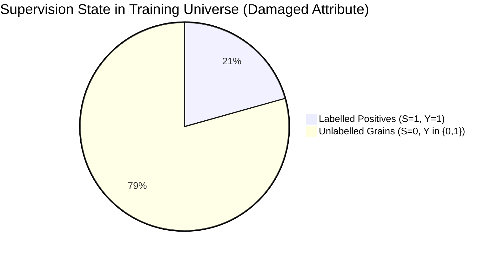
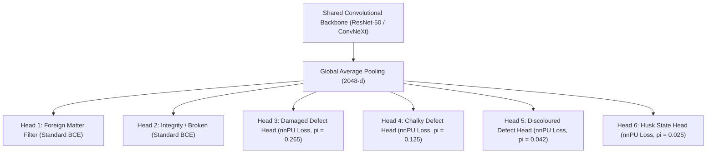

# RiceAge AI — Positive-Unlabelled (PU) Learning Framework & Mathematical Design
**Document Version:** 1.0.0  
**Phase:** 2 — Fully Automated Model Improvement  
**Effective Date:** October 31, 2026  
**Status:** Certified Methodological Specification  

---

## 1. Executive Problem Formulation: Positive-Only Supervision Failure

In the RiceAge canonical training universe ($N = 22,251$ strictly unique physical grain crops), defect annotations are strictly positive-only:
- **Damaged:** 4,592 labelled positive, 0 confirmed negative, 17,659 unlabelled.
- **Chalky:** 1,588 labelled positive, 1,085 confirmed negative (from early CVAT rounds), 19,578 unlabelled.
- **Discoloured:** 443 labelled positive, 0 confirmed negative, 21,808 unlabelled.
- **Husk State:** 129 labelled positive (partially husked/paddy), 0 confirmed negative, 22,122 unlabelled.



### 1.1 The Failure Mode of Standard Binary Cross-Entropy (BCE)
Under standard supervised learning, practitioners routinely treat all unlabelled samples ($S = 0$) as negative ($Y = 0$). This introduces fatal structural errors:
1. **Severe False-Negative Gradient Penalties:** The unlabelled set $U$ contains an estimated $1,300\text{ to }2,000$ true damaged grains. When the network correctly extracts dark necrotic features and outputs $g(x) \approx 1$, standard BCE penalizes this correct prediction with $-\log(1 - g(x))$, forcing the network to suppress true defect feature detectors.
2. **Probability Calibration Collapse:** Predictions cluster near zero, destroying confidence ranking.
3. **Severe Recall Degradation:** The classifier becomes overly conservative, failing to detect subtle defects in production.

> [!IMPORTANT]
> **Mandatory Rule:** Standard BCE treating unlabelled grains as negatives is **strictly prohibited** for defect heads. Training must use **Non-Negative Positive-Unlabelled (nnPU) learning** or **Confidence-Weighted PU learning**.

---

## 2. Mathematical Derivation of PU Risk Estimators

Let $X \in \mathcal{X}$ be the grain image representation, $Y \in \{0, 1\}$ be the true binary defect state, and $S \in \{0, 1\}$ be the labelling indicator. We observe $(X, S)$, where $S = 1 \implies Y = 1$, but $S = 0 \implies Y \in \{0, 1\}$.

Let $\pi_p = P(Y = 1)$ be the marginal class prior. The overall data distribution is:
$$p(x) = \pi_p p_p(x) + (1 - \pi_p) p_n(x)$$
Where $p_p(x) = p(x \mid Y = 1)$ and $p_n(x) = p(x \mid Y = 0)$.

### 2.1 Unbiased PU (uPU) Risk Estimator
Under the **Selected Completely At Random (SCAR)** assumption, the probability of a positive grain being labelled is independent of its visual features:
$$P(S = 1 \mid X = x, Y = 1) = c \implies p(x \mid S = 1) = p_p(x)$$

The ideal classification risk under surrogate loss $\ell(g(x), y)$ is:
$$R(g) = \pi_p \mathbb{E}_{p_p}[\ell(g(X), +1)] + (1 - \pi_p) \mathbb{E}_{p_n}[\ell(g(X), -1)]$$

Because $p_n(x)$ is unobservable, we express $(1 - \pi_p) \mathbb{E}_{p_n}[\ell(g(X), -1)]$ in terms of the marginal distribution $p(x)$ and positive distribution $p_p(x)$:
$$(1 - \pi_p) \mathbb{E}_{p_n}[\ell(g(X), -1)] = \mathbb{E}_p[\ell(g(X), -1)] - \pi_p \mathbb{E}_{p_p}[\ell(g(X), -1)]$$

Substituting yields the **Unbiased PU Risk (uPU)** (du Plessis et al., 2014):
$$R_{\text{uPU}}(g) = \pi_p \mathbb{E}_{p_p}[\ell(g(X), +1) - \ell(g(X), -1)] + \mathbb{E}_p[\ell(g(X), -1)]$$

The empirical estimator across $N_p$ labelled positives and $N_u$ unlabelled samples is:
$$\hat{R}_{\text{uPU}}(g) = \pi_p \hat{R}_p^+(g) + \hat{R}_u^-(g) - \pi_p \hat{R}_p^-(g)$$
Where:
$$\hat{R}_p^+(g) = \frac{1}{N_p} \sum_{i=1}^{N_p} \ell(g(x_i^p), +1), \quad \hat{R}_p^-(g) = \frac{1}{N_p} \sum_{i=1}^{N_p} \ell(g(x_i^p), -1), \quad \hat{R}_u^-(g) = \frac{1}{N_u} \sum_{j=1}^{N_u} \ell(g(x_j^u), -1)$$

---

### 2.2 Non-Negative PU (nnPU) Risk Estimator
When training high-capacity deep neural networks (e.g., ResNet-50, ConvNeXt), the model rapidly overfits to the finite positive sample $P$. Consequently, $\hat{R}_p^-(g)$ becomes excessively large, causing the estimated negative risk:
$$\hat{R}_n^-(g) = \hat{R}_u^-(g) - \pi_p \hat{R}_p^-(g)$$
to become **severely negative**. Once negative, minimizing $\hat{R}_{\text{uPU}}(g)$ causes gradient divergence and catastrophic overfitting.

To enforce non-negativity, du Plessis et al. (2015) introduced the **Non-Negative PU (nnPU)** estimator:
$$\hat{R}_{\text{nnPU}}(g) = \pi_p \hat{R}_p^+(g) + \max\left(0, \hat{R}_u^-(g) - \pi_p \hat{R}_p^-(g)\right)$$

During mini-batch stochastic gradient descent:
$$\mathcal{L}_{\text{batch}} = \begin{cases}
\pi_p \hat{R}_p^+(g) + \left(\hat{R}_u^-(g) - \pi_p \hat{R}_p^-(g)\right), & \text{if } \hat{R}_u^-(g) - \pi_p \hat{R}_p^-(g) \ge 0 \\
-\beta \left(\hat{R}_u^-(g) - \pi_p \hat{R}_p^-(g)\right), & \text{if } \hat{R}_u^-(g) - \pi_p \hat{R}_p^-(g) < 0
\end{cases}$$
Where $\beta \ge 0$ is a slack coefficient that applies a corrective backpropagation penalty whenever the negative risk becomes sub-zero, pushing the model back into the admissible hypothesis space.

---

## 3. Class-Prior Estimation ($\pi_p$) and Sensitivity Grid

The true class prior $\pi_p = P(Y = 1)$ is a crucial hyperparameter for nnPU learning. Since $S = 1 \implies Y = 1$, the observed positive fraction $c = N_p / N$ provides a **strict mathematical lower bound**:
$$\pi_p \ge c = \frac{N_p}{N}$$

Based on empirical lower bounds and international grain milling survey standards (Codex STAN 198-1995, IRRI, USDA 7 CFR § 868), the operating class priors and 5-point sensitivity grids have been established:

| Defect Attribute Head | Observed $N_p$ | Lower Bound ($c$) | Recommended $\hat{\pi}_p$ | 95% Confidence Interval | Sensitivity Grid ($\times \hat{\pi}_p$) |
| :--- | :---: | :---: | :---: | :---: | :---: |
| **Damaged Head** | 4,592 | **0.2064** | **0.2650** | $[0.2400, 0.2950]$ | $\{0.212, 0.239, \mathbf{0.265}, 0.292, 0.331\}$ |
| **Chalky Head** | 1,588 | **0.0714** | **0.1250** | $[0.1050, 0.1500]$ | $\{0.100, 0.113, \mathbf{0.125}, 0.138, 0.156\}$ |
| **Discoloured Head** | 443 | **0.0199** | **0.0420** | $[0.0300, 0.0550]$ | $\{0.032, 0.038, \mathbf{0.042}, 0.048, 0.057\}$ |
| **Husk State Head** | 129 | **0.0058** | **0.0250** | $[0.0150, 0.0400]$ | $\{0.018, 0.021, \mathbf{0.025}, 0.030, 0.035\}$ |

> [!NOTE]
> All parameters and sensitivity stability designations are serialized in [`class_prior_estimation.json`](file:///c:/Users/NewGen/Documents/RiceCropAnalyzer/outputs/phase2_automated/class_prior_estimation.json).

---

## 4. Confidence-Weighted PU Learning (SAR Formulation)

When defect labelling exhibits **Selected At Random (SAR)** bias (e.g., human annotators preferentially labelled large, obvious pecks while missing subtle pinholes), the SCAR assumption is relaxed:
$$e(x) = P(S = 1 \mid X = x, Y = 1) \neq c$$

We formulate a confidence-weighted two-step PU estimator:
1. **Propensity Scoring:** Train a preliminary probabilistic discriminator $s(x) = P(S = 1 \mid X = x)$ to distinguish labelled positives from unlabelled grains using standard cross-entropy with early stopping.
2. **Negative Weighting:** Using the Elkan & Noto (2008) estimator, the label frequency is estimated as $\hat{c} = \frac{1}{|V_p|} \sum_{x \in V_p} s(x)$.
3. **Posterior Probability of Defect in Unlabelled Set:**
   $$P(Y = 1 \mid X = x, S = 0) = \frac{1 - \hat{c}}{\hat{c}} \frac{s(x)}{1 - s(x)}$$
4. **Weighted Binary Objective:**
   $$\mathcal{L}_{\text{CW-PU}} = \frac{1}{N_p} \sum_{i \in P} \ell(g(x_i), 1) + \frac{1}{N_u} \sum_{j \in U} \left[ w_j^- \ell(g(x_j), 0) + w_j^+ \ell(g(x_j), 1) \right]$$
   Where $w_j^+ = P(Y = 1 \mid x_j, S = 0)$ and $w_j^- = 1 - w_j^+$.

---

## 5. Independent PU Loss Implementation per Defect Head

Because each defect represents an independent biological phenomenon (e.g., an insect bite does not prevent chalkiness, and chalkiness does not prevent husk retention), each defect head is trained with its **own dedicated PU loss function**:



### PyTorch Loss Formulation:
```python
class NonNegativePULoss(torch.nn.Module):
    def __init__(self, prior: float, beta: float = 0.0):
        super().__init__()
        self.prior = prior
        self.beta = beta
        
    def forward(self, y_pred, is_positive):
        # y_pred: logits; is_positive: 1 for labelled positive, 0 for unlabelled
        pos_mask = (is_positive == 1)
        unl_mask = (is_positive == 0)
        
        # Sigmoid probability surrogate
        prob = torch.sigmoid(y_pred)
        loss_p_pos = -torch.log(prob[pos_mask] + 1e-7).mean()
        loss_p_neg = -torch.log(1 - prob[pos_mask] + 1e-7).mean()
        loss_u_neg = -torch.log(1 - prob[unl_mask] + 1e-7).mean()
        
        neg_risk = loss_u_neg - self.prior * loss_p_neg
        if neg_risk.item() >= 0:
            loss = self.prior * loss_p_pos + neg_risk
        else:
            loss = -self.beta * neg_risk
        return loss
```
