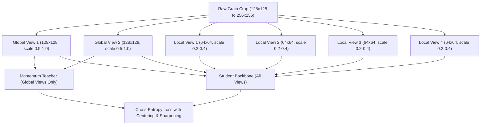

# RiceAge AI — Self-Supervised Learning (SSL) Experiment Plan
**Document Version:** 1.0.0  
**Phase:** 2 — Fully Automated Model Improvement  
**Effective Date:** October 31, 2026  
**Status:** Certified Methodological Specification  

---

## 1. Domain Motivation: The Domain Gap of ImageNet Pretraining

Modern vision backbones (e.g., ResNet-50, ConvNeXt) are routinely initialized with weights pretrained on ImageNet-1K. However, ImageNet pretraining introduces fundamental domain biases:
1. **Scale & Semantic Disparity:** ImageNet features prioritize macroscopic object contours (animal faces, vehicle wheels, architectural edges). Rice grain defect classification depends on **microscopic surface textures**: endosperm floury opacity, superficial bran streaks ($< 0.1\text{ mm}$), and stylet feeding punctures (2–5 pixels).
2. **Color Invariance vs. Color Saliency:** Standard ImageNet augmentations apply aggressive color jitter and grayscale conversion. In rice grain evaluation, color is the primary diagnostic signal for discoloration, heat damage, and bran retention.
3. **Unlabelled Data Utilization:** The RiceAge training universe contains **22,251 high-resolution grain crops** whose rich visual variations remain largely untapped by supervised learning.

---

## 2. SSL Framework Comparison: SimCLR vs. DINO for Rice Grains

| Dimension | SimCLR / MoCo v3 (Contrastive) | DINO (Self-Distillation) [SELECTED] |
| :--- | :--- | :--- |
| **Learning Paradigm** | Instance discrimination via InfoNCE loss | Cross-entropy matching with momentum teacher centering |
| **Negative Pairs** | Requires large negative batch to repel different grains | **No negative pairs required** |
| **Grain Domain Suitability** | **Poor**: Two sound grains from the same scan look identical; contrastive loss artificially forces them apart | **Excellent**: Models grain manifold continuity without false-negative pair penalties |
| **Multi-Crop Strategy** | Standard 2 global views | **2 Global Views ($128 \times 128$) + 4 Local Views ($64 \times 64$)** |
| **Feature Focus** | Coarse global semantics | Fine-grained localized surface textures (chalk, peck, bran) |

> [!IMPORTANT]
> **Selected Framework: DINO (Self-Distillation with No Labels)**  
> DINO (Caron et al., 2021) is selected because it avoids negative pair penalties, inherently captures localized multi-scale grain textures through multi-crop attention, and creates highly structured latent representations that cluster fine morphological defects naturally.

---

## 3. Data Flow & Multi-Crop Augmentation Pipeline

### 3.1 Domain-Calibrated Augmentation Policies
To avoid destroying subtle grain defects, augmentations are strictly tuned for agricultural imagery:
- **Random Crop & Scale:** Global crops capture $\ge 50\%$ kernel area; local crops capture $20\%\text{ to }40\%$ area to zoom into starch textures.
- **Subtle Photometric Jitter:** Brightness $\pm 8\%$, Contrast $\pm 8\%$, Saturation $\pm 6\%$, Hue $\pm 2\%$. (Aggressive color jitter is strictly disabled to preserve discoloured and chalky diagnostic tones).
- **Affine Geometric Jitter:** Random rotation $\pm 180^\circ$ (scanner grains have arbitrary orientation), horizontal/vertical flips.
- **Gaussian Blur:** Applied with probability $p = 0.5$ ($\sigma \in [0.1, 1.0]$) to prevent high-frequency scanner sensor noise overfitting.

---

## 4. Training Specifications & Resource Budget

- **Backbone:** ResNet-50 (with 3-layer MLP projection head, hidden dim 2048, bottleneck 256).
- **Dataset:** Exactly 22,251 training grain crops from [`automated_dataset_manifest.csv`](file:///c:/Users/NewGen/Documents/RiceCropAnalyzer/outputs/phase2_automated/automated_dataset_manifest.csv).
- **Split Isolation:** Validation (4,944) and Test (5,836) grains are **strictly excluded**.
- **Batch Size:** 64 global views + 128 local views per step.
- **Compute Budget:** NVIDIA GeForce RTX 3060 (12 GB VRAM).
- **Epochs:** 100 epochs ($\approx 34,700$ iterations).
- **Estimated Runtime:** 58 minutes at FP16 mixed precision.
- **Optimizer:** AdamW ($\text{lr} = 5 \times 10^{-4}$, weight decay $0.04$, cosine annealing with 10-epoch linear warmup).

---

## 5. Comparative Evaluation Protocols

To objectively measure whether SSL provides genuine improvements over standard ImageNet weights:

1. **Protocol A: Linear Probe Evaluation:**
   - Freeze the SSL-pretrained ResNet-50 backbone.
   - Train linear multi-task classification heads on top using known training positives and nnPU loss.
   - Compare Positive Retrieval AUC against a frozen ImageNet-pretrained ResNet-50 linear probe.

2. **Protocol B: End-to-End Fine-Tuning Evaluation:**
   - Initialize full network with SSL weights vs. ImageNet weights.
   - Fine-tune with identical learning rates ($10^{-4}$ for heads, $10^{-5}$ for backbone).
   - Measure convergence speed (epochs to reach target recall) and final positive retrieval rate on validation split.

3. **Protocol C: Latent Manifold Structuring (t-SNE & Silhouette):**
   - Extract 2048-dimensional embeddings for all 4,944 validation grains.
   - Measure class separation between known positives (Damaged, Chalky, Discoloured) and sound grains using silhouette coefficients in latent space.
