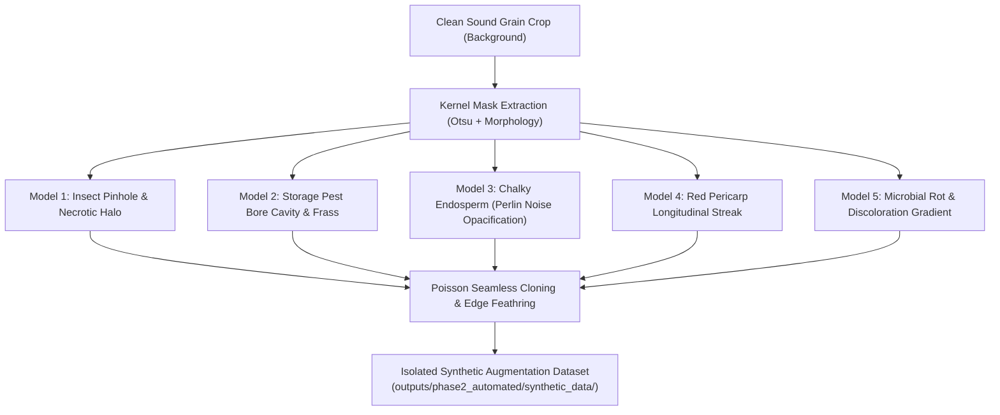

# RiceAge AI — Synthetic Defect Augmentation Specification
**Document Version:** 1.0.0  
**Phase:** 2 — Fully Automated Model Improvement  
**Effective Date:** October 31, 2026  
**Status:** Certified Methodological Specification  

---

## 1. Executive Purpose & Physical Rationale

Rare agricultural defect classes (e.g., Discoloured: 443 positives; Partially Husked: 129 positives) suffer from extreme scarcity in training data. While physical sample collection is expensive and variable, digital synthesis allows procedural generation of physically grounded defect patterns directly onto sound grains.

> [!CAUTION]
> **Scientific Integrity & Transferability Guardrails:**  
> 1. Synthetic defect images are **strictly restricted to model training experiments**.  
> 2. Synthetic examples **must NEVER be included in validation or test datasets**. Model evaluation is conducted exclusively on real-world scanner imagery.  
> 3. Synthetic augmentations are judged solely by whether they improve recall and retrieval AUC on **real historical validation positives**.

---

## 2. Procedural Defect Generation Models

### 2.1 Model 1: Insect Pinholes & Stink Bug Peck (Pre-Harvest Feeding)
- **Biological Etiology:** Piercing-sucking feeding by *Oebalus pugnax* creates a microscopic stylet puncture with surrounding enzymatic necrosis.
- **Parametric Generation:**
  - Location: Sampled randomly on kernel endosperm within the segmentation mask.
  - Pinhole Core: Radius $r_c \sim \mathcal{U}(1.2, 2.5)\text{ px}$ ($0.05\text{ to }0.10\text{ mm}$ at 600 DPI), RGB color $C_{\text{core}} \sim \mathcal{N}([35, 30, 25], 5)$.
  - Necrotic Halo: Elliptical Gaussian profile ($a, b \in [3.0, 7.0]\text{ px}$):
    $$I_{\text{halo}}(d) = I_0 \cdot \exp\left( -\frac{d^2}{2\sigma^2} \right)$$
    RGB color shifts towards brownish-yellow necrosis ($R \approx 110, G \approx 85, B \approx 45$).

### 2.2 Model 2: Storage Pest Bore Cavity (Post-Harvest Excavation)
- **Biological Etiology:** Internal hollow excavated by *Sitophilus oryzae* or *Rhyzopertha dominica*.
- **Parametric Generation:**
  - Entrance/Exit Hole: Irregular circular aperture ($r_b \sim \mathcal{U}(5.0, 10.0)\text{ px}$, $0.20\text{ to }0.42\text{ mm}$).
  - Depth Gradient: Center darkened to simulate internal hollow ($L^* \in [15, 30]$).
  - Starch Frass Fringe: Annular perimeter ($w \in [1, 2]\text{ px}$) textured with high-frequency white noise simulating pulverized endosperm meal ($L^* \in [220, 250]$).

### 2.3 Model 3: Chalky Endosperm Patches (Incomplete Starch Compaction)
- **Biological Etiology:** Loosely packed, air-void-rich amyloplasts in the dorsal, ventral (belly), or central endosperm.
- **Parametric Generation:**
  - 2D multi-octave Perlin / Simplex noise mask $M(x, y) \in [0, 1]$ thresholded at $\tau_{\text{chalk}} = 0.55$.
  - Luminance Shift: Increase luminance $L^*$ by $+35\text{ to }+65$ units in CIELAB space.
  - Translucency Suppression: Reduce color saturation $a^*, b^*$ by $60\%$, creating the characteristic milky, floury matte finish.

### 2.4 Model 4: Red Pericarp Streaks (Incomplete Bran Milling)
- **Biological Etiology:** Pigmented red rice pericarp remnants adhering along the longitudinal dorsal or ventral vascular bundle grooves.
- **Parametric Generation:**
  - Parametric spline along kernel longitudinal axis: $x(t) = x_0 + v_x t + \epsilon(t)$, $y(t) = y_0 + v_y t$.
  - Streak Length: $L \ge 0.50 \times \text{kernel length}$ (per ISO 7301 red-streaked criterion).
  - Width: $w \sim \mathcal{U}(1.5, 3.5)\text{ px}$.
  - Color Sampling: Sampled from empirical red kernel RGB distribution: $R \in [125, 160], G \in [55, 75], B \in [45, 65]$.

### 2.5 Model 5: Discoloration & Microbial Rot (Field / Storage Mold)
- **Biological Etiology:** Spreading mycelial necrosis from *Curvularia* or *Alternaria*.
- **Parametric Generation:**
  - Low-frequency spatial noise gradient originating at the embryo / germ end.
  - Color shift to tea-colored amber, deep yellow, or dark reddish-brown ($R/G/B$ ratio shifted towards dark pigment).

---

## 3. Storage Isolation & Dataset Generation Plan

All synthetic images are stored in a dedicated, isolated directory:
`outputs/phase2_automated/synthetic_data/`
- Structure:
  - `synthetic_data/peck_pinholes/` (500 synthetic crops)
  - `synthetic_data/storage_bores/` (500 synthetic crops)
  - `synthetic_data/chalky_patches/` (500 synthetic crops)
  - `synthetic_data/red_streaks/` (500 synthetic crops)
  - `synthetic_data/discoloration/` (500 synthetic crops)
- Metadata Manifest:
  `outputs/phase2_automated/synthetic_manifest.csv`:
  Tracks `source_sound_grain_id`, `defect_type_applied`, `synthetic_parameters`, `blending_mode`.

---

## 4. Transferability Evaluation Protocol

To prove that features learned from synthetic images generalize to real-world rice grains:
1. **Model A (Baseline PU):** Trained on 22,251 original training grains with nnPU loss.
2. **Model B (Synthetic Augment PU):** Trained on 22,251 original training grains + 2,500 synthetic defect crops with nnPU loss.
3. **Evaluation on 100% Real Validation Imagery:**
   - Both models are evaluated strictly on the **4,944 real canonical validation instances**.
   - Measure Recall@95% Precision and Positive Retrieval Rate on real validation positives.
   - **Acceptance Criterion:** Synthetic augmentation must improve validation positive retrieval AUC by $\ge +1.5\%$ on real defects without increasing unlabelled false-alarm rate.
