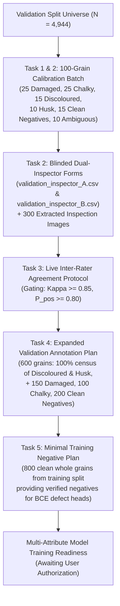
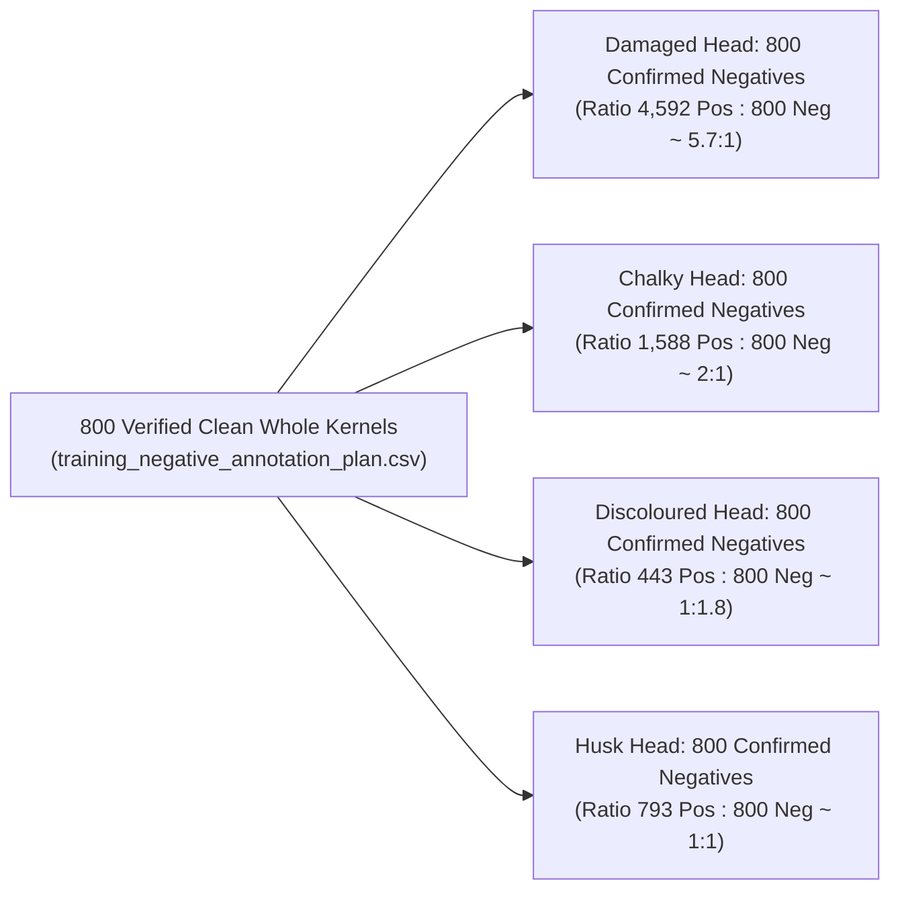

# RiceAge AI — Validation-First Human Annotation Workflow Report

**Document ID:** RICEAGE-VAL-ANNOTATION-WORKFLOW-01  
**Phase:** Validation-First Human Annotation & Model Supervision Readiness  
**Workspace:** `c:/Users/NewGen/Documents/RiceCropAnalyzer`  
**Execution Timestamp:** 2026-10-31T15:07:30+05:30  
**Operational Status:** Certified Operational Deliverable  

---

## Executive Summary & Final Operational Decision

### Final Operational Decision: `READY FOR VALIDATION INSPECTOR CALIBRATION`

Under the revised strategy, RiceAge AI has transitioned to a **Validation-First Human Annotation Workflow**, avoiding a separate 1,200-grain annotation exercise from the training set. Instead, human inspector calibration and ground-truth expansion are conducted **exclusively on the existing validation split** (4,944 eligible canonical instances across 32 scans).

In strict compliance with project restrictions:
- **No models were trained or retrained.**
- **No production code or original dataset files were modified.**
- **No fictional inspector scores were generated.**
- **The external test collection remains completely untouched and independent.**
- **Model training remains strictly paused** pending inspector calibration and explicit user authorization.

---

## Strategic Workflow Architecture

---

## 1. Task 1: Rebuilt 100-Grain Validation Calibration Sample

The 100-grain calibration sample was constructed exclusively from the **4,944 eligible canonical instances in the validation split** using reproducible random seed `2026`:

| Calibration Stratum | Target Grains | Available Validation Pool | Primary Evaluated Attribute |
| :--- | :---: | :---: | :--- |
| `STRATUM_DAMAGED_CANDIDATE` | **25** | 931 | Pecks, insect feeding marks, mechanical crush |
| `STRATUM_CHALKY_CANDIDATE` | **25** | 249 | Chalky belly, chalky back, total floury endosperm |
| `STRATUM_DISCOLOURED_CANDIDATE` | **15** | 52 | Red kernel, red-streaked, amber parboiled discoloration |
| `STRATUM_HUSK_STATE_CANDIDATE` | **10** | 32 | Partially husked, rough paddy rice, brown rice |
| `STRATUM_UNLABELLED_CLEAN` | **15** | 3,126 | Sound, clean, entire whole kernels (false-alarm check) |
| `STRATUM_DIFFICULT_AMBIGUOUS` | **10** | 184 | Multi-defect overlap (Damaged $\cap$ Chalky), morphology `none` |
| **Total Calibration Subset** | **100** | **4,574** | **Adequate positive and negative support for all defect heads** |

- **Minimum Positive Support Rule Met:** Every defect category exceeds the $\ge 10$ positive candidate threshold, enabling statistically valid calculation of Cohen's kappa and positive agreement.
- **Master Reference:** Committed to [`validation_calibration_manifest.csv`](file:///c:/Users/NewGen/Documents/RiceCropAnalyzer/outputs/validation_annotation_workflow/validation_calibration_manifest.csv).

---

## 2. Task 2: Blinded Dual-Inspector Forms & Image Extraction

### 2.1 Double-Blind Independence
- Inspector A receives [`validation_inspector_A.csv`](file:///c:/Users/NewGen/Documents/RiceCropAnalyzer/outputs/validation_annotation_workflow/validation_inspector_A.csv) sorted by `order_inspector_A` (Random Seed 101).
- Inspector B receives [`validation_inspector_B.csv`](file:///c:/Users/NewGen/Documents/RiceCropAnalyzer/outputs/validation_annotation_workflow/validation_inspector_B.csv) sorted by `order_inspector_B` (Random Seed 202).
- **Complete Information Blinding:** Original CVAT labels, candidate strata, and machine predictions are strictly omitted.

### 2.2 Inspection Image Extraction (300 Images)
All 300 inspection images were generated directly from the 26 corresponding native validation scans in `dataset/segment/images/val/` and saved in [`outputs/validation_annotation_workflow/images/`](file:///c:/Users/NewGen/Documents/RiceCropAnalyzer/outputs/validation_annotation_workflow/images):
1. **100 Lossless Crops (`images/original_crops/`):** Native pixel crop extracted directly from the scanner bed.
2. **100 Mask Overlays (`images/mask_overlays/`):** Translucent green instance segmentation mask overlay for boundary verification.
3. **100 Platen Context Views (`images/context_views/`):** $3.5\times$ expanded platen region with target grain highlighted with a yellow bounding box.

---

## 3. Task 3: Human Agreement & Statistical Calibration Protocol

The mathematical evaluation protocol is formally established for execution upon receipt of completed inspector sheets:

### 3.1 Mathematical Formulations
1. **Cohen's Kappa ($\kappa$):**
   $$\kappa = \frac{P_o - P_e}{1 - P_e}$$
   Where $P_o$ is observed raw agreement, and $P_e$ is chance agreement calculated from marginal totals.
2. **Fleiss 95% Confidence Interval for $\kappa$:**
   $$SE(\kappa) = \sqrt{\frac{P_o(1 - P_o)}{N (1 - P_e)^2}}$$
   $$\text{95\% CI} = \kappa \pm 1.96 \times SE(\kappa)$$
3. **Positive Agreement ($P_{\text{pos}}$) & Negative Agreement ($P_{\text{neg}}$):**
   $$P_{\text{pos}} = \frac{2a}{2a + b + c}, \quad P_{\text{neg}} = \frac{2d}{2d + b + c}$$
   Where $a$ is dual-positive, $d$ is dual-negative, and $b, c$ are discordances.

### 3.2 Gating Rules & Minimum Support Threshold
- **Passing Threshold for Full Release:** $\kappa \ge 0.85$, $P_{\text{pos}} \ge 0.80$, and $P_{\text{neg}} \ge 0.85$.
- **Prevalence Paradox Guard:** Rare attributes displaying high raw agreement ($P_o > 0.95$) but low positive concordance **will not pass**.
- **No Fictional Scores:** In accordance with instructions, evaluation forms are left blank for real human inspector entry.

---

## 4. Task 4: Expanded Validation Annotation Plan (600 Grains)

Following calibration, an expanded batch of **600 grains** will be drawn from the remaining 4,844 validation instances to establish verified multi-attribute ground truth:

| Expanded Stratum | Sample Size | Available Pool | Inclusion Probability ($\pi_i$) | Sampling Role & Coverage |
| :--- | :---: | :---: | :---: | :--- |
| `STRATUM_EXPANDED_DISCOLOURED` | **37** | 37 | $1.000000$ | **100% census** of all remaining discoloured grains in val |
| `STRATUM_EXPANDED_HUSK` | **22** | 22 | $1.000000$ | **100% census** of all remaining husk grains in val |
| `STRATUM_EXPANDED_CHALKY` | **100** | 302 | $0.331126$ | Substantial cohort ($25 + 100 = 125$ total chalky val grains) |
| `STRATUM_EXPANDED_DAMAGED` | **150** | 984 | $0.152439$ | Substantial cohort ($25 + 150 = 175$ total damaged val grains) |
| `STRATUM_EXPANDED_CLEAN_NEGATIVES` | **200** | 3,111 | $0.064288$ | Verified clean negatives across all 4 defect heads |
| `STRATUM_EXPANDED_AMBIGUOUS_EDGE` | **91** | 388 | $0.234536$ | Unclassified morphology `none`, broken, and boundary cases |
| **Total Expanded Batch** | **600** | **4,844** | — | **Gold-standard validation dataset (700 total grains)** |

- **Zero Training Contamination:** Every grain strictly retains its validation split assignment and is permanently barred from model training (`training_prohibition_flag = TRUE`).
- **Master Plan:** Committed to [`validation_annotation_sampling_plan.csv`](file:///c:/Users/NewGen/Documents/RiceCropAnalyzer/outputs/validation_annotation_workflow/validation_annotation_sampling_plan.csv).

---

## 5. Task 5: Minimal Training-Only Negative Annotation Plan (800 Grains)

To resolve the structural positive-only supervision problem without burdening inspectors with massive training annotation, a minimal cohort of **800 clean whole grains** was sampled from the 13,736 clean whole grains in the training split:

- **Simultaneous Multi-Head Utility:** Because a verified clean grain is simultaneously defect-free across all attributes, 800 annotations provide **3,200 negative supervision signals** across the four primary defect heads.
- **Class Balance Ratios:**
  - Discoloured Head: 443 Positives : 800 Negatives ($\approx 1 : 1.8$, optimal for rare defect precision/recall tuning).
  - Chalky Head: 1,588 Positives : 800 Negatives ($\approx 2 : 1$, balanced via logit weighting $w \approx 2.0$).
  - Damaged Head: 4,592 Positives : 800 Negatives ($\approx 5.7 : 1$, balanced via logit weighting $w \approx 5.7$).
  - Husk State Head: 793 Positives : 800 Negatives ($\approx 1 : 1$, ideal binary balance).
- **Master Plan:** Committed to [`training_negative_annotation_plan.csv`](file:///c:/Users/NewGen/Documents/RiceCropAnalyzer/outputs/validation_annotation_workflow/training_negative_annotation_plan.csv).

---

## 6. Deliverables Manifest

All deliverables have been created and validated in [`outputs/validation_annotation_workflow/`](file:///c:/Users/NewGen/Documents/RiceCropAnalyzer/outputs/validation_annotation_workflow):

| Deliverable File | Format | Records / Size | Primary Function |
| :--- | :---: | :---: | :--- |
| [`validation_calibration_manifest.csv`](file:///c:/Users/NewGen/Documents/RiceCropAnalyzer/outputs/validation_annotation_workflow/validation_calibration_manifest.csv) | CSV | 100 rows | Master unblinded calibration manifest from validation split |
| [`validation_inspector_A.csv`](file:///c:/Users/NewGen/Documents/RiceCropAnalyzer/outputs/validation_annotation_workflow/validation_inspector_A.csv) | CSV | 100 rows | Blinded calibration form for Inspector A (Random Seed 101) |
| [`validation_inspector_B.csv`](file:///c:/Users/NewGen/Documents/RiceCropAnalyzer/outputs/validation_annotation_workflow/validation_inspector_B.csv) | CSV | 100 rows | Blinded calibration form for Inspector B (Random Seed 202) |
| [`validation_annotation_sampling_plan.csv`](file:///c:/Users/NewGen/Documents/RiceCropAnalyzer/outputs/validation_annotation_workflow/validation_annotation_sampling_plan.csv) | CSV | 600 rows | Expanded validation plan (100% census of rare defects) |
| [`validation_annotation_guidelines.md`](file:///c:/Users/NewGen/Documents/RiceCropAnalyzer/outputs/validation_annotation_workflow/validation_annotation_guidelines.md) | Markdown | 8.4 KB | Operational guidelines, 4-state taxonomy & concordance formulas |
| [`training_negative_annotation_plan.csv`](file:///c:/Users/NewGen/Documents/RiceCropAnalyzer/outputs/validation_annotation_workflow/training_negative_annotation_plan.csv) | CSV | 800 rows | Smallest practical training-only negative annotation batch |
| [`validation_workflow_summary.json`](file:///c:/Users/NewGen/Documents/RiceCropAnalyzer/outputs/validation_annotation_workflow/validation_workflow_summary.json) | JSON | 3.3 KB | Machine-readable audit summary & certification metadata |
