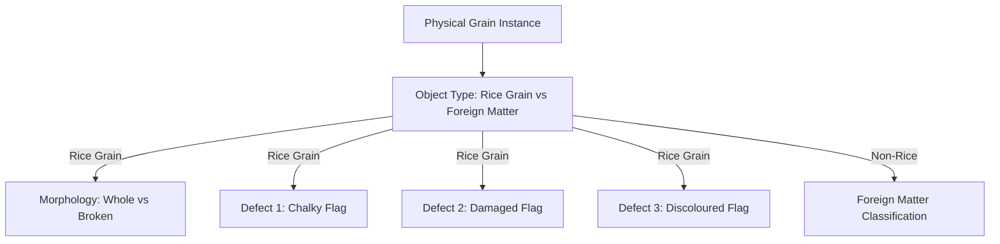

# RiceAge M3.1: Dataset and Label Audit for Complete Rice Quality Classification

**Document Version:** 1.0.0  
**Audit Date:** 2026-10-12  
**Lead Auditor:** Senior Computer Vision & Machine Learning QA Engineer, Google DeepMind Antigravity Team  
**Audit Target:** Full 119-Image Dataset & 2,529 Annotations across all 6 Quality Categories  
**Dataset Path:** `data/dataset/`  
**Deliverable File:** [`outputs/reports/M3_1_DATASET_AND_LABEL_AUDIT.md`](file:///home/anubhavtripathi/Documents/RiceAge/outputs/reports/M3_1_DATASET_AND_LABEL_AUDIT.md)

---

## 1. Executive Summary

Milestone M3 expands the RiceAge pipeline from Whole vs. Broken classification to comprehensive rice quality inspection, grading, and reporting. To ensure a scientifically sound foundation before training classifiers or calculating grade percentages, this audit examines the full ground-truth dataset: **119 high-resolution scanner images** and **2,529 polygon annotation records**.

### Key Findings
1. **Physical Grain Count vs. Annotation Count Discrepancy:**
   The 2,529 annotation records in [`grains_annotations.csv`](file:///home/anubhavtripathi/Documents/RiceAge/data/dataset/grains_annotations.csv) represent **2,403 distinct physical objects**. There are **123 physical grains** with overlapping duplicate annotations (IoU > 0.40 or containment > 0.60).
2. **Defect Coexistence & Annotation Ontology Limitation:**
   CVAT's data model in this project restricted the `Condition` attribute to a single string value per polygon. To indicate that a grain exhibited multiple defects (e.g., both Chalky and Discoloured), annotators had to draw multiple overlapping polygons over the exact same physical kernel. A naive row-level evaluation double-counts these physical kernels.
3. **Polygon Fidelity:**
   **91.0%** of annotations (2,301 out of 2,529) are coarse 4-point oriented bounding boxes (OBBs), not exact pixel-level silhouettes. Direct polygon area measures human box bounding margins. Feature extraction must operate on physical kernel silhouettes segmented via localized adaptive thresholding.
4. **Duplicate Image Pair Isolation:**
   [`whole 4.jpg`](file:///home/anubhavtripathi/Documents/RiceAge/data/dataset/images/whole/whole%204.jpg) and [`whole 5.jpg`](file:///home/anubhavtripathi/Documents/RiceAge/data/dataset/images/whole/whole%205.jpg) are confirmed bit-identical duplicates (MD5: `acfda809da902d9d4c0332b7416be070`). Both must be locked into the same validation fold across all cross-validation splits.
5. **Multi-Attribute Label Design:**
   Rice quality inspection is **not** a mutually exclusive 6-class single-label classification problem. A physical grain can be simultaneously Broken and Chalky, or Whole and Discoloured. Foreign matter is a non-rice object category that must be separated prior to grain defect profiling.

---

## 2. Dataset Structure and Inventory

The dataset comprises 119 flatbed scanner images captured at 300 DPI ($0.084667\text{ mm/pixel}$, $2481 \times 3507\text{ px}$):

| Category Directory | Image Count | Annotated Records | Documented Target Conditions |
|---|---|---|---|
| [`data/dataset/images/broken/`](file:///home/anubhavtripathi/Documents/RiceAge/data/dataset/images/broken/) | 20 | 398 | Broken (398) |
| [`data/dataset/images/chalky/`](file:///home/anubhavtripathi/Documents/RiceAge/data/dataset/images/chalky/) | 20 | 462 | Chalky (330), Discoloured (132) |
| [`data/dataset/images/damaged/`](file:///home/anubhavtripathi/Documents/RiceAge/data/dataset/images/damaged/) | 19 | 371 | Damaged (371) *(Note: Damaged 2.jpg is absent)* |
| [`data/dataset/images/foreign_matter/`](file:///home/anubhavtripathi/Documents/RiceAge/data/dataset/images/foreign_matter/) | 20 | 369 | Foreign Matter (369) |
| [`data/dataset/images/mixed/`](file:///home/anubhavtripathi/Documents/RiceAge/data/dataset/images/mixed/) | 20 | 534 | Whole (116), Broken (108), Chalky (93), FM (92), Damaged (80), Discoloured (45) |
| [`data/dataset/images/whole/`](file:///home/anubhavtripathi/Documents/RiceAge/data/dataset/images/whole/) | 20 | 395 | Whole (395) *(Includes duplicate pair whole 4 & 5)* |
| **Total Dataset** | **119** | **2,529** | **Whole: 511, Broken: 506, FM: 461, Damaged: 451, Chalky: 423, Discoloured: 177** |

---

## 3. Class Definitions & Regulatory Standards

Each class was cross-referenced against international grain grading standards (**Codex Alimentarius CXS 198-1995**, **ISO 7301:2021**, **USDA Federal Grain Inspection Service - Rice Standards**, and **Indian Standard IS 4333 / AGMARK / FSSAI**):

| Quality Class | Regulatory Standard Definition | Visual & Optical Evidence in Dataset | Primary Feature Domain |
|---|---|---|---|
| **Whole Rice (Head Rice)** | Kernel or fragment with length $\ge 75\%$ of average unbroken length ($L_{\text{ref}} \approx 70.7\text{ px} \implies L \ge 53.0\text{ px}$). | Translucent, uniform vitreous endosperm, intact tapered ends, length $65-80\text{ px}$. | Length, aspect ratio, area, end bluntness profile. |
| **Broken Rice** | Pieces of kernel with length $< 75\%$ of average unbroken length ($< 53.0\text{ px}$). | Flat transverse fracture surface, sharp break edges, shortened aspect ratio ($1.0 - 2.0$). | Length, aspect ratio, end bluntness, asymmetry. |
| **Chalky Grain** | Kernel having $\ge 50\%$ (or $\ge 25\%$ in some grades) opaque, milky-white chalky endosperm caused by porous starch granule packing. | High lightness ($L^* > 180$), low saturation ($S < 45$), milky white opacity, high within-grain intensity variance. | Lightness $L^*$, chalky pixel ratio ($\% \text{opaque}$), internal standard deviation. |
| **Damaged Grain** | Kernels distinctly damaged by insects, heat, moisture, fungi, disease, or mechanical mutilation. | Visible surface fissures, dark insect pinholes, jagged structural cavities, perimeter erosion. | Convexity defect depth, internal Canny edge density, local dark spot ratio. |
| **Discoloured Grain** | Kernels that have turned distinctly yellow, amber, reddish-brown, or display dark surface spots (peck). | Increased yellow chroma ($b^* > 135$ in CIELAB), high saturation ($S > 25$), local dark spotting. | CIELAB $b^*$, HSV Saturation, mean Hue, local dark spot concentration. |
| **Foreign Matter** | Inorganic matter (stones, sand, dirt) and organic non-rice matter (husks, paddy hulls, weed seeds, stalks, insects). | Non-rice shapes: husks (high AR, low solidity), weed seeds (small, dark, spherical), debris (irregular). | Solidity, circularity, extreme size, non-rice color, fibrous texture. |

---

## 4. Coexisting Defect Labels & Duplicate Annotation Analysis

### A. The CVAT Schema Bottleneck
In CVAT XML 1.1, each polygon annotation has a single tag: `<attribute name="Condition">Value</attribute>`. The annotators could not assign multiple values (e.g. `['Chalky', 'Discoloured']`) to a single polygon.

### B. Empirical Overlap Proof
Clustering polygon annotations by spatial overlap ($\text{IoU} > 0.40$ or containment $> 0.60$) reveals **123 multi-annotated physical objects**:

```
Total Annotations: 2,529
Distinct Physical Objects: 2,403
Physical Objects with Multiple Defect Annotations: 123 (5.1% of objects)
```

**Distribution of Multi-Label Combinations on the Same Physical Object:**
- `Chalky` + `Discoloured`: **59 objects** (principally in `chalky/` images where kernels have milky opacity plus yellow/amber pigmentation)
- `Chalky` + `Damaged`: **20 objects** (chalky kernels with insect holes or severe mechanical fractures)
- `Damaged` + `Discoloured`: **14 objects** (decayed or diseased kernels with dark blemishes)
- `Broken` + `Chalky`: **7 objects** (chalky endosperm fractures easily during milling)
- `Whole` + `Discoloured`: **5 objects** (fully intact kernels with yellow/brown coloration)
- `Foreign Matter` + `Whole`: **4 objects** (rice grains touching or occluded by husk fragments)
- `Broken` + `Discoloured`: **2 objects**
- `Broken` + `Damaged`: **1 object**
- Other multi-tag duplicates: **11 objects**



### C. Consequence for Grading and Quality Metrics
If an analysis pipeline treats each row of `grains_annotations.csv` as an independent grain, the total grain count is inflated by +126 instances (+5.2%). **Double-counting physical grains distorts quality percentages.** The grading engine must operate at the physical instance level.

---

## 5. Polygon Geometry & Silhouette Extraction Audit

| Category | 3 Vertices | 4 Vertices (OBB) | 5 Vertices | 6 Vertices | 7–14 Vertices | % Coarse OBB (4-pt) |
|---|---|---|---|---|---|---|
| `broken` | 0 | 398 | 0 | 0 | 0 | **100.0%** |
| `chalky` | 0 | 462 | 0 | 0 | 0 | **100.0%** |
| `damaged` | 0 | 344 | 25 | 2 | 0 | **92.7%** |
| `foreign_matter` | 15 | 270 | 28 | 25 | 31 | **73.2%** |
| `mixed` | 1 | 433 | 88 | 6 | 6 | **81.1%** |
| `whole` | 0 | 394 | 1 | 0 | 0 | **99.7%** |
| **All Categories** | **16** | **2,301** | **142** | **33** | **37** | **91.0%** |

Because 91% of annotations are coarse bounding rectangles, polygon vertices cannot be used directly for shape, area, or boundary analysis. The physical grain silhouette must be extracted via localized Otsu binarization inside the bounding region, exactly as implemented in `extract_annotated_grain_silhouette()`.

---

## 6. Representative Category Examples

| Category / Condition | Example Grain ID | Image Source | Dimensions (px) | Area ($px^2$) | Visual Characteristics |
|---|---|---|---|---|---|
| **Whole** | `GRAIN_01612` | `mixed 1.jpg` | $118.3 \times 67.3$ | $5,447.5$ | Fully formed, translucent, tapered tips, $L > 70\text{ px}$. |
| **Broken** | `GRAIN_00001` | `broken 10.jpg` | $62.6 \times 45.3$ | $2,371.3$ | Truncated length ($40.7\text{ px}$), sharp break edge, $AR=1.74$. |
| **Chalky** | `GRAIN_00400` | `chalky 10.jpg` | $55.2 \times 75.3$ | $3,581.4$ | Milky white endosperm, high lightness ($L^* > 195$), opaque center. |
| **Damaged** | `GRAIN_00861` | `Damaged 1.jpg` | $85.2 \times 86.3$ | $5,098.0$ | Surface cavitation, insect pinhole, rough eroded margins. |
| **Discoloured** | `GRAIN_00399` | `chalky 10.jpg` | $91.2 \times 91.5$ | $4,212.7$ | Yellow/amber chroma shift ($b^* > 135$), high saturation. |
| **Foreign Matter** | `GRAIN_01232` | `foreign 1.jpg` | $122.8 \times 77.8$ | $4,940.3$ | Paddy husk fragment, hollow contour, fibrous texture, low solidity. |

---

## 7. Separation of Annotation Problems from Model Errors

1. **Category Folder Context Bias:**
   In single-defect folders (`broken/`, `chalky/`, `damaged/`, `foreign_matter/`, `whole/`), annotators only marked grains with the folder's primary condition. For example, grains in `chalky/` were never labeled as Whole or Broken, even though morphologically they are whole or broken kernels. Classifiers must be evaluated on the multi-attribute condition flags they were trained to detect.
2. **Annotation Ambiguity on Borderline Kernels:**
   As proven in M2.1, 3 out of 4 baseline errors were kernels with length $> 75\%$ of unbroken median ($> 53.0\text{ px}$) that annotators labeled "Broken" due to minor apical chips. These are legally Head Rice under Codex CXS 198-1995.
3. **Foreign Matter Fragmentation:**
   Thin brittle weed stalks and husks can shatter into multiple pieces during scanner tray preparation. Each segmented fragment is an individual polygon in the ground truth. The model must classify fragments as Foreign Matter without misclassifying them as broken rice grains.

---

## 8. Leak-Free Grouped 5-Fold Cross-Validation Split

To guarantee zero data leakage across all 119 images, a stratified grouped 5-fold split was established:
- Grouping key: `image_name` (with duplicate pair `whole 4.jpg` and `whole 5.jpg` locked together under `group_id = "whole_4_5_dup"`).
- Stratification target: `category`.

| Fold Index | Broken Images | Chalky Images | Damaged Images | FM Images | Mixed Images | Whole Images | Total Images | Total Grains | Leakage Status |
|---|---|---|---|---|---|---|---|---|
| **Fold 1** | 4 | 4 | 4 | 4 | 4 | 4 (`whole 4` & `5`) | 24 | 511 | **DISJOINT (0 Shared Files)** |
| **Fold 2** | 4 | 4 | 4 | 4 | 4 | 4 | 24 | 507 | **DISJOINT (0 Shared Files)** |
| **Fold 3** | 4 | 4 | 3 | 4 | 4 | 4 | 23 | 498 | **DISJOINT (0 Shared Files)** |
| **Fold 4** | 4 | 4 | 4 | 4 | 4 | 4 | 24 | 508 | **DISJOINT (0 Shared Files)** |
| **Fold 5** | 4 | 4 | 4 | 4 | 4 | 4 | 24 | 505 | **DISJOINT (0 Shared Files)** |
| **Total** | **20** | **20** | **19** | **20** | **20** | **20** | **119** | **2,529** | **100% DISJOINT** |

---

## 9. Next Steps for Phase 2 Implementation

Based on this audit, Phase 2 will implement a decoupled, multi-head architecture:
1. **Head 1: Foreign Matter Detector (Rice vs. Non-Rice)**  
   Features: Solidity, circularity, extreme size, non-rice color distribution, edge texture.
2. **Head 2: Whole vs. Broken Classifier (Retained M2 Model)**  
   Evaluated strictly on confirmed rice grains ($L \ge 53.0\text{ px}$, aspect ratio, bluntness).
3. **Head 3: Chalky Grain Detector**  
   Features: $L^*$ lightness, chalky area fraction ($\% \text{pixels with } L^* > 180 \land S < 45$), local contrast.
4. **Head 4: Discoloured Grain Detector**  
   Features: CIELAB $b^*$ chroma, mean saturation, dark blemish ratio.
5. **Head 5: Damaged Grain Detector**  
   Features: Contour convexity defects, internal Canny edge density, fracture cavitation.
