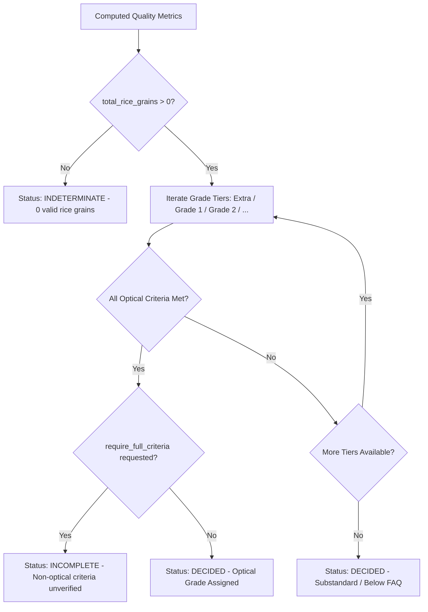

# RiceAge M3.3: Quality Grading Engine Architecture & Standards Specification

**Document Version:** 1.0.0  
**Audit Date:** 2026-10-12  
**Lead Auditor:** Senior Computer Vision & Machine Learning QA Engineer, Google DeepMind Antigravity Team  
**Module Target:** [`src/quality_grading.py`](file:///home/anubhavtripathi/Documents/RiceAge/src/quality_grading.py)  
**Deliverable File:** [`outputs/reports/M3_3_GRADING_RULES.md`](file:///home/anubhavtripathi/Documents/RiceAge/outputs/reports/M3_3_GRADING_RULES.md)

---

## 1. Architectural Principles of Sample-Level Grading

Milestone M3 establishes the formal grading layer that maps instance-level classifications into regulatory quality grades. The engine enforces five foundational engineering principles:

1. **Object Type Separation:** Foreign matter (non-rice debris) is reported separately from rice grains and is never counted in the rice grain denominator.
2. **Defect Coexistence Without Double-Counting:** Rice kernels exhibiting multiple defects (e.g., a broken kernel with chalky endosperm and surface blemish) contribute exactly **1 count** to `total_rice_grains`. Defect flags are computed as independent attributes.
3. **Explicit Denominator Mathematics:** Every percentage reported defines its mathematical denominator unambiguously.
4. **Standards Traceability:** Grading thresholds are not arbitrary hardcoded constants; each profile references its legal citation and issuing authority.
5. **Indeterminate State Enforcement:** When required regulatory criteria cannot be measured optically (e.g., moisture content by drying oven, odor by sensory panel), the system marks the decision as `INCOMPLETE` or `INDETERMINATE` rather than falsely claiming certified compliance.

---

## 2. Denominator Definitions & Mathematical Formulation

Let $\mathcal{O}$ be the set of all detected physical objects in a scanned sample tray:

$$\mathcal{O} = \mathcal{R} \cup \mathcal{F}, \quad \mathcal{R} \cap \mathcal{F} = \emptyset$$

where $\mathcal{R}$ is the set of confirmed rice kernels ($N_{\text{rice}} = |\mathcal{R}|$) and $\mathcal{F}$ is the set of foreign matter objects ($N_{\text{FM}} = |\mathcal{F}|$). Total detected objects is $N_{\text{total}} = N_{\text{rice}} + N_{\text{FM}}$.

### A. Morphology Decomposition
Every rice kernel $r \in \mathcal{R}$ is partitioned into Whole or Broken:
$$\mathcal{R} = \mathcal{W} \cup \mathcal{B}, \quad \mathcal{W} \cap \mathcal{B} = \emptyset \implies N_{\text{rice}} = N_{\text{whole}} + N_{\text{broken}}$$

- **Whole Rice Percentage ($\% \text{Whole}$):**
  $$\% \text{Whole} = \frac{N_{\text{whole}}}{N_{\text{rice}}} \times 100\%$$
- **Broken Rice Percentage ($\% \text{Broken}$):**
  $$\% \text{Broken} = \frac{N_{\text{broken}}}{N_{\text{rice}}} \times 100\%$$

### B. Defect Percentages
Let $\mathcal{C} \subseteq \mathcal{R}$ be chalky grains, $\mathcal{D}_{\text{mg}} \subseteq \mathcal{R}$ be damaged grains, and $\mathcal{D}_{\text{sc}} \subseteq \mathcal{R}$ be discoloured grains:
- **Chalky Grain Percentage ($\% \text{Chalky}$):**
  $$\% \text{Chalky} = \frac{|\mathcal{C}|}{N_{\text{rice}}} \times 100\%$$
- **Damaged Grain Percentage ($\% \text{Damaged}$):**
  $$\% \text{Damaged} = \frac{|\mathcal{D}_{\text{mg}}|}{N_{\text{rice}}} \times 100\%$$
- **Discoloured Grain Percentage ($\% \text{Discoloured}$):**
  $$\% \text{Discoloured} = \frac{|\mathcal{D}_{\text{sc}}|}{N_{\text{rice}}} \times 100\%$$

### C. Foreign Matter Percentage
- **Foreign Matter Percentage ($\% \text{FM}$):**
  $$\% \text{Foreign Matter} = \frac{N_{\text{FM}}}{N_{\text{total}}} \times 100\%$$

> [!IMPORTANT]
> Because $|\mathcal{C} \cap \mathcal{B}| \ge 0$, summing percentages across categories $(\% \text{Broken} + \% \text{Chalky} + \dots)$ is mathematically invalid. Defect percentages are parallel rates over the rice population, not a single partition of unity.

---

## 3. Supported Grading Profiles & Quality Standards

[`src/quality_grading.py`](file:///home/anubhavtripathi/Documents/RiceAge/src/quality_grading.py) pre-configures three major international and national grading frameworks:

### Profile 1: Codex Alimentarius CXS 198-1995 (Revised 2019)
- **Issuing Authority:** Codex Alimentarius Commission (FAO / WHO)
- **Legal Citation:** Codex Standard for Rice CXS 198-1995: Section 3 Quality Factors

| Grade Tier | Max Broken (%) | Max Chalky (%) | Max Damaged (%) | Max Discoloured (%) | Max Foreign Matter (%) |
|---|---|---|---|---|---|
| **Extra** | $\le 5.0\%$ | $\le 2.0\%$ | $\le 1.5\%$ | $\le 0.5\%$ | $\le 0.1\%$ |
| **Grade 1** | $\le 10.0\%$ | $\le 3.0\%$ | $\le 2.0\%$ | $\le 1.0\%$ | $\le 0.2\%$ |
| **Grade 2** | $\le 15.0\%$ | $\le 5.0\%$ | $\le 3.0\%$ | $\le 2.0\%$ | $\le 0.5\%$ |
| **Grade 3** | $\le 25.0\%$ | $\le 8.0\%$ | $\le 4.0\%$ | $\le 3.0\%$ | $\le 1.0\%$ |

- **Unsupported Regulatory Criteria:**
  1. *Moisture content:* Max $15.0\%\text{ m/m}$ (requires air-oven drying at $130^\circ\text{C}$).
  2. *Odor:* Must be free from abnormal flavors, musty or sour odors (requires sensory evaluation).
  3. *Live insects:* Free from live insects and mites.

---

### Profile 2: USDA Milled Rice Standards (7 CFR Part 868)
- **Issuing Authority:** USDA Federal Grain Inspection Service (FGIS)
- **Legal Citation:** United States Standards for Milled Rice (7 CFR § 868.201 - 868.212)

| Grade Tier | Max Broken (%) | Max Chalky (%) | Max Damaged (%) | Max Discoloured (%) | Max Foreign Material (%) |
|---|---|---|---|---|---|
| **US No. 1** | $\le 4.0\%$ | $\le 2.0\%$ | $\le 0.5\%$ | $\le 0.1\%$ | $\le 0.1\%$ |
| **US No. 2** | $\le 7.0\%$ | $\le 4.0\%$ | $\le 1.0\%$ | $\le 0.2\%$ | $\le 0.2\%$ |
| **US No. 3** | $\le 15.0\%$ | $\le 6.0\%$ | $\le 1.5\%$ | $\le 0.5\%$ | $\le 0.5\%$ |
| **US No. 4** | $\le 25.0\%$ | $\le 8.0\%$ | $\le 2.0\%$ | $\le 1.0\%$ | $\le 1.0\%$ |
| **US No. 5** | $\le 35.0\%$ | $\le 10.0\%$ | $\le 3.0\%$ | $\le 2.0\%$ | $\le 1.5\%$ |
| **US No. 6** | $\le 50.0\%$ | $\le 15.0\%$ | $\le 4.0\%$ | $\le 3.0\%$ | $\le 2.0\%$ |

- **Unsupported Regulatory Criteria:**
  1. *Moisture content:* Max $14.0\%$ (requires Motomco/DICKEY-john meter).
  2. *Red rice and damaged kernels by mass:* Evaluated gravimetrically in grams.
  3. *Odor:* Free from commercially objectionable foreign odors.

---

### Profile 3: Indian Standard IS 4333 / AGMARK Rice Grading Rules
- **Issuing Authority:** Bureau of Indian Standards (BIS) / Directorate of Marketing & Inspection (DMI)
- **Legal Citation:** IS 4333 (Parts 1-5): Methods of Analysis for Foodgrains; Agricultural Produce (Grading and Marking) Act

| Grade Tier | Max Broken (%) | Max Chalky (%) | Max Damaged (%) | Max Discoloured (%) | Max Foreign Matter (%) |
|---|---|---|---|---|---|
| **Grade I** | $\le 5.0\%$ | $\le 3.0\%$ | $\le 1.0\%$ | $\le 1.0\%$ | $\le 0.5\%$ |
| **Grade II** | $\le 10.0\%$ | $\le 5.0\%$ | $\le 2.0\%$ | $\le 2.0\%$ | $\le 1.0\%$ |
| **Grade III** | $\le 20.0\%$ | $\le 8.0\%$ | $\le 3.0\%$ | $\le 3.0\%$ | $\le 1.5\%$ |
| **Below FAQ** | Exceeds Grade III defect limits | | | | |

- **Unsupported Regulatory Criteria:**
  1. *Moisture content:* Max $14.0\%$ (IS 4333 Part 2).
  2. *Inorganic vs Organic split:* Requires chemical acid digestion and analytical balance.
  3. *Uric acid content:* Max $100\text{ mg/kg}$ (enzymatic assay).

---

## 4. Grading Decision Protocol & Indeterminate Handling

### Indeterminate State Triggers:
1. **Zero Valid Grains:** If a scan contains only non-rice objects ($N_{\text{rice}} = 0$), status is `INDETERMINATE`.
2. **Missing External Criteria:** If the user specifies `require_full_criteria=True`, status is marked `INCOMPLETE`, and `unsupported_criteria` explicitly lists missing laboratory tests.
3. **Substandard Sample:** If a sample fails the lowest grade tier, it is marked `Substandard / Below FAQ` with explicit failure reasons recorded for each tier.
