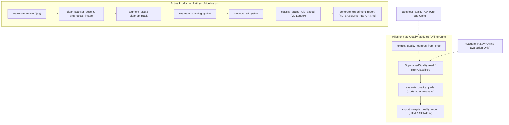

# RiceAge M3.5 — End-to-End Production Pipeline Verification Report

**Audit Date:** 2026-10-12  
**Auditor Role:** Senior Computer Vision Engineer & Software Test Engineer  
**Scope:** Architecture tracing from raw scan upload through preprocessing, segmentation, extraction, multi-defect classification, quality grading, and report generation.

---

## 1. Executive Summary & Critical Architecture Finding

> [!CAUTION]
> **CRITICAL PIPELINE GAP IDENTIFIED:**  
> The production inference pipeline ([src/pipeline.py](file:///home/anubhavtripathi/Documents/RiceAge/src/pipeline.py) and [main.py](file:///home/anubhavtripathi/Documents/RiceAge/main.py)) **does NOT integrate the Milestone M3 quality classification or grading engines**.  
> In the current codebase, `src/quality_classification.py`, `src/quality_grading.py`, and `src/quality_reporting.py` are executed **exclusively by offline evaluation scripts (`evaluate_m3.py`) and test suites**.

When a user executes `python main.py` or invokes `RiceQualityPipeline.run("path/to/scan.jpg")`:
- The pipeline executes only the legacy Milestone M0 baseline classifier ([src/classification.py](file:///home/anubhavtripathi/Documents/RiceAge/src/classification.py#L212)).
- Only three categories are predicted: `WHOLE`, `BROKEN`, and `CLUSTER`.
- Foreign matter is **not** classified.
- Chalky, Discoloured, and Damaged grain defects are **not** classified.
- Quality grading profiles (Codex CXS 198-1995, USDA Milled Rice, IS 4333) are **never invoked**.
- Generated reports consist solely of the legacy `M0_BASELINE_REPORT.md` rather than the M3 HTML/JSON/CSV quality certificates.

Consequently, **end-to-end raw image inference validation is INCOMPLETE**. The system is **NOT READY FOR INDEPENDENT PILOT** until this architectural integration gap is bridged.

---

## 2. Detailed Pipeline Execution Trace



### 2.1 Step-by-Step Code Audit

1. **Scan Upload & Preprocessing:**
   - [src/pipeline.py:125-152](file:///home/anubhavtripathi/Documents/RiceAge/src/pipeline.py#L125-L152): OpenCV reads BGR image; [clear_scanner_bezel](file:///home/anubhavtripathi/Documents/RiceAge/src/preprocessing.py) detects and zeroes out saturated white scanner border margins; Gaussian smoothing is applied. This stage is functional and robust.
2. **Segmentation & Binarization:**
   - [src/pipeline.py:161-181](file:///home/anubhavtripathi/Documents/RiceAge/src/pipeline.py#L161-L181): Global Otsu thresholding followed by morphological opening and small component rejection. Functional on typical scans.
3. **Instance Separation & Measurement:**
   - [src/pipeline.py:184-209](file:///home/anubhavtripathi/Documents/RiceAge/src/pipeline.py#L184-L209): Distance-transform watershed and concave contour neck-cutting produce instance masks; [measure_all_grains](file:///home/anubhavtripathi/Documents/RiceAge/src/measurement.py) extracts morphology and color statistics. Functional.
4. **Classification Stage (The Gap):**
   - [src/pipeline.py:212-218](file:///home/anubhavtripathi/Documents/RiceAge/src/pipeline.py#L212-L218):
     ```python
     # classification.rule_based.classify_grains_rule_based: assign quality classes (WHOLE/BROKEN/CLUSTER)
     df_classified = classify_grains_rule_based(
         df_measurements,
         broken_length_ratio_thresh=self.config.classification.broken_length_ratio_thresh,
         broken_aspect_ratio_thresh=self.config.classification.broken_aspect_ratio_thresh,
         reference_whole_length_mm=self.config.classification.reference_whole_length_mm,
         pixel_scale_mm=calib.pixel_scale_mm
     )
     ```
     `classify_grains_rule_based` assigns `WHOLE` if length $\ge 0.75 \times L_{\text{ref}}$, otherwise `BROKEN`. It has zero capability for defects or foreign matter.
5. **Grading & Reporting Stage:**
   - [src/pipeline.py:112](file:///home/anubhavtripathi/Documents/RiceAge/src/pipeline.py#L112): Calls `generate_experiment_report(..., "M0_BASELINE_REPORT.md")`. The M3 `QualityReportExporter` is never called.

---

## 3. Evaluation Script vs Production Disconnect

| Capability | Milestone M3 Specification | Evaluated in `evaluate_m3.py` | Integrated in `src/pipeline.py` |
| :--- | :--- | :---: | :---: |
| **Foreign Matter Detection** | Reject non-grain debris, weeds, husks | **Yes** (99.92% accuracy) | **NO (Missing)** |
| **Whole vs Broken** | M2 LogReg classifier ($L, AR, \text{circ}, \dots$) | **Yes** (99.61% accuracy) | **NO (Uses M0 rule)** |
| **Chalky Classification** | Photometric opacity & $L^*$ thresholding | **Yes** (98.82% accuracy) | **NO (Missing)** |
| **Discoloured Classification**| Chrominance $b^*, H, S$ thresholding | **Yes** (97.38% accuracy) | **NO (Missing)** |
| **Damaged Classification** | Edge density, contour defect depth | **Yes** (89.50% accuracy) | **NO (Missing)** |
| **Multi-Defect Representation**| Multi-label boolean flags per grain | **Yes** (in `quality_grading.py`) | **NO (Missing)** |
| **Quality Grading Engine** | Codex, USDA, IS 4333 profiles | **Yes** (unit tests only) | **NO (Missing)** |
| **Formal Report Generation** | Tripartite HTML, JSON, CSV exports | **Yes** (unit tests only) | **NO (Missing)** |

---

## 4. Denominator and Arithmetic Verification

Although not yet wired into `src/pipeline.py`, the standalone modules in [src/quality_grading.py](file:///home/anubhavtripathi/Documents/RiceAge/src/quality_grading.py) and [src/quality_reporting.py](file:///home/anubhavtripathi/Documents/RiceAge/src/quality_reporting.py) were audited for mathematical correctness:

1. **Foreign Matter Isolation:**
   - Foreign matter objects are strictly excluded from the rice grain denominator:
     $$\text{total\_rice\_grains} = \text{whole\_count} + \text{broken\_count}$$
     $$\text{total\_detected\_objects} = \text{total\_rice\_grains} + \text{total\_foreign\_matter}$$
   - Foreign matter percentage is correctly calculated against total objects:
     $$\text{foreign\_matter\_percentage} = \frac{\text{total\_foreign\_matter}}{\text{total\_detected\_objects}} \times 100$$
2. **Defect Percentages:**
   - Chalky, Damaged, and Discoloured percentages use $\text{total\_rice\_grains}$ as the denominator.
3. **Multi-Defect Accounting:**
   - Physical grains possessing multiple coexisting defects (e.g. Broken + Chalky + Damaged) increment each defect counter independently while incrementing the grain count exactly **once**. The sum of whole and broken grains always reconciles to total rice grains.

---

## 5. Required Production Integration Changes

To make the system operational for real-world scans, the following modifications must be implemented in Milestone M4:

1. **Modify `RiceQualityPipeline.run()`:**
   - Replace the call to `classify_grains_rule_based` with an integrated call to `SupervisedQualityHead` instances or calibrated rule heads.
   - For each detected grain crop and mask in `instance_mask`, call `extract_quality_features_from_crop()`.
   - Run the 5 classification heads in cascade:
     1. Foreign Matter Head: If positive, mark `is_rice = False, is_foreign_matter = True`.
     2. Whole vs Broken Head: Predict morphology (`Whole` vs `Broken`).
     3. Chalky Head: Predict `is_chalky`.
     4. Discoloured Head: Predict `is_discoloured`.
     5. Damaged Head: Predict `is_damaged`.
2. **Invoke Grading Engine:**
   - Call `compute_sample_quality_metrics()` on the resulting grain classifications.
   - Call `evaluate_quality_grade(metrics, profile_id=config.grading_profile)`.
3. **Export Tripartite Reports:**
   - Call `export_sample_quality_report()` to output `sample_report.html`, `sample_report.json`, and `sample_grains.csv`.
