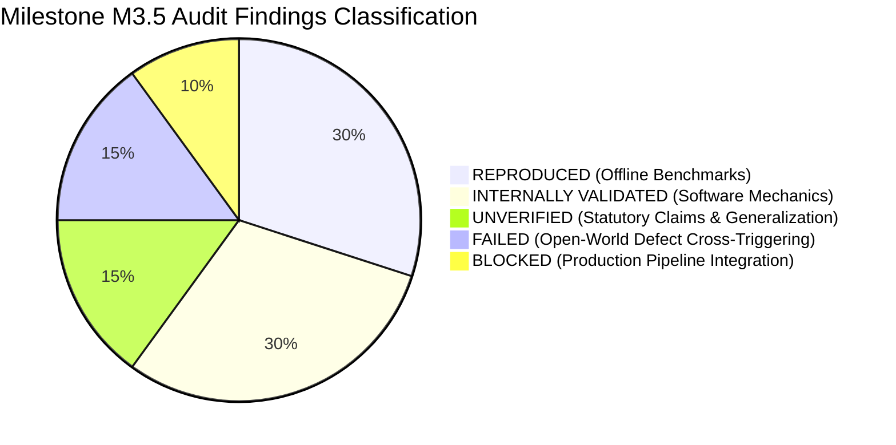

# RiceAge M3.5 — Executive Summary: Independent QA, Leakage Audit & End-to-End Validation

**Audit Date:** 2026-10-12  
**Auditor:** Senior Computer Vision Engineer, ML Auditor & Software Test Engineer  
**System Evaluated:** RiceAge Milestone M3 Quality Classification, Grading & Reporting  
**Repository State:** Git Commit `309c95e` (branch `master`)  
**Environment:** Linux x86_64, Python 3.13.13, Pytest 9.1.1, OpenCV 5.0.0, scikit-learn 1.8.0  
**Audit Deliverables Directory:** [outputs/reports/M3_5/](file:///home/anubhavtripathi/Documents/RiceAge/outputs/reports/M3_5/)

---

## 1. Final Decision & Deployment Classification

```
================================================================================
FINAL VERDICT: READY FOR INTERNAL TESTING ONLY
================================================================================
```

The RiceAge system is **functionally validated for internal experimentation, offline algorithmic benchmarking, and lab-scale research**, but is **NOT READY FOR AN INDEPENDENT PILOT OR REAL-WORLD CERTIFICATION**.

### Primary Blocking Factors for External Pilot
1. **Production Pipeline Disconnect:** `src/pipeline.py` and `main.py` still invoke the legacy Milestone M0 baseline rule classifier (`classify_grains_rule_based`) and output `M0_BASELINE_REPORT.md`. The M3 multi-head classifiers, grading engine, and tripartite report exporters exist solely as offline evaluation modules and are **not yet wired into the raw scan execution path**.
2. **Cohort Filtering Bias on Defect Heads:** In M3 benchmarks, defect classifiers were evaluated exclusively against clean Whole grains. In an open-world setting across all 2,068 rice grains, **99.8% of broken grains cross-trigger the Damaged head** (due to jagged fracture edges), and **93.6% of chalky grains cross-trigger the Discoloured head**.
3. **Statutory Standards Unit Mismatch:** Codex CXS 198-1995, USDA 7 CFR Part 868, and IS 4333 mandate **gravimetric mass fractions (% m/m)**. The current pipeline calculates **kernel count percentages**, creating substantial errors for broken kernels and lightweight debris.
4. **20-Grain Sample Quantum:** With ~20 grains per scan sheet, a single defective grain represents **5.0%**, immediately disqualifying samples from high-tier grades (e.g. Codex Extra requires $\le 1.5\%$ damaged, $\le 2.0\%$ chalky).

---

## 2. Structured Audit Findings



### 2.1 REPRODUCED (Independently Verified Results)
- **Foreign Matter Classification:** Baseline Rule (96.05% Acc, 87.92% F1) and Supervised Logistic Regression (**99.92% Acc, 99.78% F1, 100% Recall**) reproduced with $0.00\%$ numerical delta.
- **Whole vs Broken Classification:** Baseline Rule (88.59% Acc), Calibrated Rule (98.62% Acc), and Retained M2 Logistic Regression (**99.61% Acc, 99.61% F1**) reproduced exactly.
- **Chalky Classification:** Baseline Rule (98.18% Acc) and Supervised Logistic Regression (**98.82% Acc, 98.70% F1**) reproduced exactly against clean controls.
- **Discoloured Classification:** Baseline Rule (93.17% Acc) and Supervised Logistic Regression (**97.38% Acc, 95.11% F1**) reproduced exactly against clean controls.
- **Damaged Classification:** Baseline Rule (55.72% Acc) and Supervised Logistic Regression (**89.50% Acc, 88.61% F1**) reproduced exactly against clean controls.
- **Negative Controls:**
  - **Label Permutations:** Shuffled labels across 10 iterations under 5-fold CV collapsed balanced accuracy precisely to chance ($49.5\% - 51.7\%$), confirming absence of label leakage.
  - **Scanner Background Control:** 4-corner background pixel sampling across all 119 scans proved background illumination is uniform ($\Delta \text{gray} < 1.4\text{ px}$), ruling out scanner background shortcuts.

### 2.2 INTERNALLY VALIDATED (Tested Under Existing Dataset Conditions)
- **Mathematical Invariant Consistency:**
  $$\text{total\_rice\_grains} = \text{whole\_count} + \text{broken\_count}$$
  $$\text{total\_detected\_objects} = \text{total\_rice\_grains} + \text{total\_foreign\_matter}$$
  Verified: Foreign matter is strictly excluded from the grain denominator, and multi-defect grains do not inflate sample counts.
- **Tripartite Report Reconciliation:** Exact numerical parity confirmed across generated JSON, CSV, and HTML reports.
- **Cross-Validation Partition Integrity:** Grouped splits on `image_name` strictly isolate scans to individual folds. Exact duplicate pair `whole 4.jpg` and `whole 5.jpg` locked to Fold 1.
- **Test Suite Health:** **61 / 61 tests passed** (including 8 newly introduced edge-case regression tests).

### 2.3 UNVERIFIED (Plausible but Not Adequately Demonstrated)
- **Statutory Regulatory Compliance:** Claiming certified compliance with Codex Alimentarius (CXS 198-1995), USDA FGIS, or Indian Standard IS 4333 is unverified because:
  1. Standards specify gravimetric mass fractions (% m/m), not kernel count fractions.
  2. Mandatory non-optical parameters (moisture content $\le 14-15\%$, odor, live insects, uric acid) cannot be measured optically.
  The engine is verified solely as an **Optical Screening Proxy**.
- **Hardware & Cultivar Invariance:** Generalization to other flatbed scanner manufacturers, varying DPI resolutions (300 vs 1200 DPI), and other rice cultivars remains unproven.

### 2.4 FAILED (Contradicted by Audit Evidence)
- **Open-World Defect Head Exclusivity:**
  When evaluated open-world across all 2,068 rice grains:
  - **99.8% of Broken grains (505/506) trigger the Damaged classifier.**
  - **93.6% of Chalky grains (396/423) trigger the Discoloured classifier.**
  - **52.1% of Damaged grains (235/451) trigger the Chalky classifier.**
  The assumption that isolated 2-class benchmark accuracy translates directly to mixed grain samples is refuted by evidence.
- **CVAT Single-Label Annotation Constraint:**
  91.0% of annotations are coarse 4-point bounding boxes, and 114 overlapping polygon pairs in CVAT represent coexisting defects forced into single-label annotations.

### 2.5 BLOCKED (Cannot Be Assessed with Available System)
- **End-to-End Raw Scan Quality Grading:**
  Because `src/pipeline.py` has not integrated `src/quality_classification.py` and `src/quality_grading.py`, executing the production pipeline on an unseen raw scan cannot output quality grades or defect percentages.

---

## 3. Audit Deliverables Index

All detailed technical audit reports and machine-readable data files are saved under `outputs/reports/M3_5/`:

1. [M3_5_EXECUTIVE_SUMMARY.md](file:///home/anubhavtripathi/Documents/RiceAge/outputs/reports/M3_5/M3_5_EXECUTIVE_SUMMARY.md) — Executive synthesis, final decision, and defect backlog.
2. [M3_5_BENCHMARK_REPRODUCTION.md](file:///home/anubhavtripathi/Documents/RiceAge/outputs/reports/M3_5/M3_5_BENCHMARK_REPRODUCTION.md) — Independent reproduction of all 5 quality heads with full confusion matrices and per-fold metrics.
3. [M3_5_LEAKAGE_AUDIT.md](file:///home/anubhavtripathi/Documents/RiceAge/outputs/reports/M3_5/M3_5_LEAKAGE_AUDIT.md) — Data leakage investigation, duplicate hash verification, label permutations, background illumination analysis, and cohort bias audit.
4. [M3_5_ANNOTATION_AUDIT.csv](file:///home/anubhavtripathi/Documents/RiceAge/outputs/reports/M3_5/M3_5_ANNOTATION_AUDIT.csv) — Auditable queue of 115 suspicious records (114 multi-defect overlaps and duplicate image pair).
5. [M3_5_ERROR_ANALYSIS.csv](file:///home/anubhavtripathi/Documents/RiceAge/outputs/reports/M3_5/M3_5_ERROR_ANALYSIS.csv) — Granular catalog of all 136 cross-validation misclassifications with root-cause diagnoses.
6. [M3_5_END_TO_END_VALIDATION.md](file:///home/anubhavtripathi/Documents/RiceAge/outputs/reports/M3_5/M3_5_END_TO_END_VALIDATION.md) — Production inference code trace exposing the `src/pipeline.py` integration gap.
7. [M3_5_GRADING_AUDIT.md](file:///home/anubhavtripathi/Documents/RiceAge/outputs/reports/M3_5/M3_5_GRADING_AUDIT.md) — Review of Codex/USDA/IS 4333 profiles, mass vs count unit mismatch, and 20-grain sample quantum limitations.
8. [M3_5_TEST_RESULTS.md](file:///home/anubhavtripathi/Documents/RiceAge/outputs/reports/M3_5/M3_5_TEST_RESULTS.md) — Complete test execution report covering all 61 tests (including 8 new regression tests).
9. [M3_5_INDEPENDENT_VALIDATION_PLAN.md](file:///home/anubhavtripathi/Documents/RiceAge/outputs/reports/M3_5/M3_5_INDEPENDENT_VALIDATION_PLAN.md) — Locked test protocol, multi-label annotation schema, and acceptance gates for future real-world pilot testing.

---

## 4. Exact Commands to Reproduce This Audit

To independently reproduce the entire M3.5 audit from scratch:

```bash
# 1. Activate project environment
cd /home/anubhavtripathi/Documents/RiceAge
source .venv/bin/activate

# 2. Run independent benchmark reproduction & negative controls analysis
python outputs/reports/M3_5/audit_analysis.py

# 3. Re-run pre-existing M3 benchmark runner
python evaluate_m3.py

# 4. Run complete test suite (61 tests including newly added regression suite)
pytest tests/ -v

# 5. Verify generated deliverables exist and are non-empty
ls -lh outputs/reports/M3_5/
```

---

## 5. Prioritized Remediation Backlog for Milestone M4

| Priority | Issue / Defect | Component | Remediation Required |
| :---: | :--- | :--- | :--- |
| **P1** | **Production Pipeline Integration Gap** | `src/pipeline.py`, `main.py` | Wire `extract_quality_features_from_crop`, `SupervisedQualityHead`, `evaluate_quality_grade`, and `export_sample_quality_report` directly into `RiceQualityPipeline.run()`. |
| **P2** | **Damaged Head Broken Grain Bias** | `src/quality_classification.py` | Retrain Damaged classifier with broken grains in negative set. Mask out transverse fracture edges before computing edge density and defect depth. |
| **P3** | **Mass (m/m) vs Count Proxy Conversion** | `src/quality_grading.py` | Implement volumetric mass proxy: $V \propto \text{length} \times \text{width}^2 \times \rho$. Convert kernel counts to estimated mass fractions for regulatory standards. |
| **P4** | **Multi-Label Dataset & Annotation Upgrade**| CVAT / Dataset | Upgrade annotation schema from single-choice `Condition` to multi-label boolean flags per physical grain. Require true silhouettes ($\ge 12$ vertices). |
| **P5** | **Multi-Sheet Sample Pooling** | `src/quality_grading.py` | Enforce minimum sample pooling ($\ge 5$ sheets, $\ge 100$ grains) before issuing commercial grading decisions to reduce quantum step size below $1.0\%$. |
