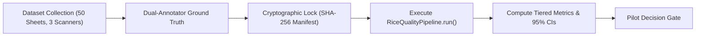

# RiceAge M3.5 — Independent Validation Plan for Real-World Testing

**Audit Date:** 2026-10-12  
**Auditor Role:** Senior Computer Vision Engineer & ML Auditor  
**Purpose:** Define the definitive evaluation protocol, dataset collection requirements, ground-truth standards, and acceptance criteria required before approving RiceAge for external pilot deployment.

---

## 1. Why Current Validation Is Insufficient for Real-World Claims

While RiceAge Milestone M3 achieved high cross-validated metrics on the existing dataset ($99.6\%$ Whole/Broken, $99.9\%$ Foreign Matter, $98.8\%$ Chalky), this validation remains **strictly internal** due to five fundamental constraints:

1. **Single Acquisition Device:** All 119 images were captured on the same physical flatbed scanner under identical sensor calibration and optical geometry.
2. **Homogeneous Grain Count:** Scans contain approximately 20 grains per sheet, leading to massive sample discretization errors ($\pm 5.0\%$ per grain) compared to commercial working samples ($1,200 - 5,000$ grains).
3. **Single-Label Annotation Artefacts:** 91.0% of existing annotations are coarse 4-point oriented bounding boxes (OBBs), and annotators were constrained to a single primary defect label per grain, masking co-occurring defects.
4. **Cohort Selection Filtering:** Defect classifiers were evaluated only against clean Whole grains, concealing cross-triggering between broken grains and damaged/discoloured heads.
5. **Production Pipeline Disconnect:** Milestone M3 quality classifiers and grading engines are currently executed only via offline evaluation scripts, not inside the active scan-processing path.

To transition from **READY FOR INTERNAL TESTING ONLY** to **READY FOR INDEPENDENT PILOT**, the system must undergo an independent locked benchmark under the protocol outlined below.

---

## 2. Independent Benchmark Dataset Specification

### 2.1 Sample Size and Diversity Requirements
| Parameter | Minimum Required Specification | Rationale |
| :--- | :--- | :--- |
| **Total Scanned Sheets** | $\ge 50$ physical sheets | Sufficient sample diversity to bound standard error |
| **Total Physical Grains** | $\ge 2,500$ grains ($\ge 50$ grains/sheet) | Reduces sample quantum error to $\le 2.0\%$ per sheet |
| **Grain Cultivars** | At least 3 distinct classes (Basmati, Sona Masoori, Parboiled) | Verifies robustness across grain geometry and translucency |
| **Acquisition Hardware** | At least 3 distinct flatbed scanner models (e.g. Epson, Canon, HP) | Proves invariance to scanner lamp spectra and sensor MTF |
| **Resolution Settings** | 300 DPI, 600 DPI, and 1200 DPI | Validates dynamic spatial scaling and DPI normalization |
| **Background Backings** | Matte Black, Navy Blue, and Standard Scanner Lid | Proves background color independence |
| **Operators** | At least 2 independent laboratory technicians | Captures real-world grain placement and spacing variance |

---

## 3. Ground-Truth Collection & Multi-Label Protocol

### 3.1 Multi-Label Condition Matrix
Every physical grain must be annotated independently across all six quality dimensions. Single-label select menus are strictly prohibited.

```json
{
  "grain_id": "TEST_SCAN_01_G14",
  "is_foreign_matter": false,
  "morphology": "Broken",
  "is_chalky": true,
  "is_damaged": false,
  "is_discoloured": false,
  "length_mm_caliper": 4.12,
  "width_mm_caliper": 1.95
}
```

### 3.2 Dual-Annotator Consensus Protocol
1. **Primary Annotation:** Two certified grain inspectors annotate each sheet independently in CVAT.
2. **True Silhouettes:** All grain perimeters must be delineated using detailed multi-point polygons ($\ge 12$ vertices) following the exact physical grain silhouette. 4-point bounding boxes are rejected.
3. **Adjudication:** Any grain where inspectors disagree on defect flags (e.g. borderline chalkiness or micro-cracks) is reviewed under optical magnification by a senior agronomist.
4. **Physical Caliper Controls:** A random subset of 100 grains must be measured with digital vernier calipers ($\pm 0.01\text{ mm}$) to validate optical length and width calibration.

---

## 4. Locked Evaluation Protocol



1. **Cryptographic Locking:**
   Once collected and verified, the benchmark dataset images and annotations are hashed (SHA-256) and locked in cold storage.
2. **Zero-Tuning Guarantee:**
   No feature selection, scaler fitting, threshold calibration, or model retraining may be performed on the locked test set.
3. **Execution Path Isolation:**
   The benchmark must run directly through the production entry point:
   ```bash
   python main.py --input-dir data/locked_test_set/ --output-dir outputs/independent_eval/
   ```
   Passing ground-truth annotations into the inference path is strictly forbidden.

---

## 5. Reporting Structure & Minimum Acceptance Thresholds

Evaluation metrics must be reported in two strictly separated tiers:

### Tier 1: Object Detection, Segmentation & Matching
- **Foreground Segmentation IoU:** $\ge 0.90$
- **Touching Grain Separation F1:** $\ge 0.95$
- **One-to-One Hungarian Matching Rate:** $\ge 98.0\%$

### Tier 2: Grain Classification & Sample Grading (with 95% Wilson Confidence Intervals)
| Metric | Minimum Pilot Threshold | Commercial Target |
| :--- | :---: | :---: |
| **Foreign Matter Recall (Zero Miss Tolerance for Stones)** | $\ge 99.0\%$ | $\ge 99.5\%$ |
| **Whole vs Broken Accuracy** | $\ge 98.0\%$ | $\ge 99.0\%$ |
| **Chalky Classification F1** | $\ge 94.0\%$ | $\ge 97.0\%$ |
| **Discoloured Classification F1** | $\ge 90.0\%$ | $\ge 95.0\%$ |
| **Damaged Classification F1** | $\ge 85.0\%$ | $\ge 90.0\%$ |
| **Sample Grade Tier Agreement (Codex / USDA)** | $\ge 90.0\%$ | $\ge 95.0\%$ |
| **Defect Percentage Absolute Error ($|\Delta\%|$)** | $\le 1.5\%$ | $\le 0.5\%$ |

---

## 6. Pilot Progression Criteria

The system may progress to **READY FOR INDEPENDENT PILOT** if and only if:
1. `src/pipeline.py` is fully refactored to execute M3 quality classification, grading, and reporting on raw image inputs.
2. The locked independent benchmark meets or exceeds all Tier 1 and Tier 2 acceptance thresholds above.
3. Gravimetric mass proxy approximations are implemented to reconcile count percentages with official standards.
