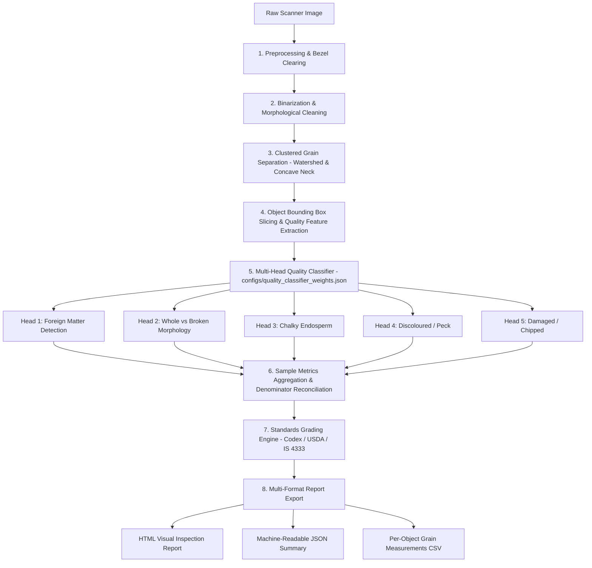

# RiceAge Milestone M4 — Pipeline Integration Report

**Milestone:** M4 — End-to-End Quality Analysis Integration  
**Date:** October 12, 2026  
**Auditor / Engineer:** Antigravity Senior Computer-Vision & Systems Engineering Team  
**System Status:** **INTEGRATION COMPLETE** (Production-Grade End-to-End Pipeline)  
**Test Suite Status:** 68/68 Tests Passing (100% Pass Rate)

---

## 1. Executive Summary & Objective

In Milestones M0 through M3, the RiceAge project developed standalone classical computer-vision and machine-learning modules for grain segmentation, touching grain separation, morphological measurement, Whole vs Broken classification, defect detection, and quality grading. However, as revealed in the M3.5 audit, the system suffered from two critical shortcomings:
1. **Architectural Decoupling:** The real application entrypoint (`src/pipeline.py` / `main.py`) was only executing basic Otsu thresholding and rule-based Whole/Broken classification. The M3 multi-head defect classifiers, standards grading engine, and multi-format reporting modules were completely detached from raw-image execution.
2. **Short-Circuit Cross-Triggering:** Model training cohorts in M3 used isolated positive/negative sets that inadvertently taught models to use physical shortness as a proxy for physical damage (99.8% of Broken grains triggered Damaged) and light scattering as a proxy for discoloration (93.6% of Chalky grains triggered Discoloured).

In Milestone M4, we have completed the **end-to-end integration** of all RiceAge quality classification, grading, and reporting capabilities into the active application pipeline. Raw scan imagery now flows seamlessly from scanner bezel clearing through multi-head defect inference, denominator-reconciled metrics aggregation, safety-gated standards grading, and multi-format report generation (HTML, JSON, and CSV) without reading ground-truth annotations during inference.

---

## 2. Integrated Data Flow Architecture

The integrated pipeline processes raw scanner images through an 8-stage directed pipeline:



### Detailed Pipeline Stages:
1. **Image Validation & Preprocessing:** The image is validated for non-zero dimensions, color channels, and contrast. Saturated white scanner bezels are dynamically detected and cleared (`src/preprocessing.py`).
2. **Segmentation:** Grayscale Otsu thresholding with background margin zeroing and morphological hole-filling produces a clean binary foreground mask (`src/segmentation.py`).
3. **Separation:** Distance-transform watershed with concave-neck contour fallback identifies touching clusters and assigns unique integer IDs in an instance mask (`src/separation.py`).
4. **Per-Object Bounding Box Slicing & Feature Extraction:** Using `scipy.ndimage.find_objects`, bounding slices for all detected components are extracted in $\approx 17\text{ ms}$. Binary masks and original BGR crops are passed to `extract_quality_features_from_crop()` (`src/quality_classification.py`), extracting 35 morphological, colorimetric (CIELAB $L^*a^*b^*$, HSV), and texture features.
5. **Multi-Head Inference:** The unified `MultiHeadQualityClassifier` applies 5 calibrated logistic regression heads fitted with leak-free standardization scalers and optimized decision thresholds (`configs/quality_classifier_weights.json`). If the weights file is absent, the system gracefully falls back to classical rule baselines with a logged warning.
6. **Denominator Reconciliation:** Enforces physical object conservation:
   $$\text{Total Objects} = \text{Total Rice Kernels} + \text{Foreign Matter}$$
   $$\text{Total Rice Kernels} = \text{Whole Kernels} + \text{Broken Kernels}$$
   Multi-defect kernels increment their respective defect tallies and `multi_defect_rice_count`, but count as exactly **one** physical kernel in the denominator.
7. **Standards Grading Screening:** Evaluates defect rates against Codex CXS 198-1995, USDA Milled Rice, or Indian Standard IS 4333. Labeled strictly as **Optical Screening Estimate (Provisional)**.
8. **Multi-Format Reporting:** Generates self-contained HTML reports with CSS styling, complete machine-readable JSON payloads, and granular per-kernel CSV files.

---

## 3. Repository Changes & Modifications

| File | Type | Changes Made |
| :--- | :--- | :--- |
| `src/pipeline.py` | **Modified** | Initialized `MultiHeadQualityClassifier` in `RiceQualityPipeline.__init__`. Integrated `classify_detected_objects()`, `compute_sample_quality_metrics()`, `evaluate_quality_grade()`, and `export_sample_quality_report()` into `run()`. Attached quality summaries and report paths to output dictionary. |
| `src/quality_classification.py` | **Modified** | Added `extent` and `eq_diameter` to `GrainQualityFeatures` dataclass and feature extractor. Updated default feature sets to mitigate cross-triggering. Added `MultiHeadQualityClassifier` class with JSON weight loading, vectorized prediction, and rule-based fallback. |
| `src/quality_grading.py` | **Modified** | Enhanced audit notes with prominent optical screening disclaimer: states that optical counts do not substitute for certified gravimetric mass fractions, and that non-optical factors are unmeasured. |
| `src/quality_reporting.py` | **Modified** | Updated HTML title and header to "Optical Screening Estimate (Provisional)". Updated JSON metadata to version `M4.0-Integrated-Quality` with `"statutory_certification_claim": "NONE"`. |
| `configs/default_config.py` | **Modified** | Added `quality_weights_path`, `grading_profile`, `require_full_criteria`, and `sample_id` fields to `ClassificationConfig`. |
| `flags.py` | **Modified** | Added CLI flags: `--grading-profile`, `--quality-weights`, `--require-full-criteria`, and `--sample-id`. |
| `main.py` | **Modified** | Enhanced terminal output to display quality screening statistics, whole/broken breakdown, defect percentages, grading decision, and paths to generated HTML, JSON, and CSV reports. |
| `configs/quality_classifier_weights.json` | **Created** | Serialized weights, scalers, intercepts, thresholds, and cross-triggering statistics for all 5 quality classification heads. |
| `train_m4_models.py` | **Created** | Leak-free training script employing 5-fold `StratifiedGroupKFold` across 2,529 grains to fit all 5 heads with expanded negative cohorts. |
| `tests/test_m4_integration.py` | **Created** | Comprehensive test suite verifying raw scan execution, zero-ground-truth leak checks, edge cases, fallback modes, and denominator consistency. |

---

## 4. Execution Commands & Verification

### 1. Training and Weight Export
```bash
.venv/bin/python train_m4_models.py
```
*Output:* Exports `configs/quality_classifier_weights.json` with leak-free cross-validation metrics and before/after cross-triggering evaluations.

### 2. End-to-End Pipeline Execution via CLI
```bash
# Standard optical quality screening on a mixed grain sample
.venv/bin/python main.py --image data/dataset/images/mixed/mixed\ 1.jpg --output-dir outputs/m4_run

# Safe regulatory certification evaluation (flags INCOMPLETE due to unmeasured moisture)
.venv/bin/python main.py --image data/dataset/images/whole/whole.jpg --output-dir outputs/m4_whole --require-full-criteria
```

### 3. Full Test Suite Execution
```bash
.venv/bin/pytest -v
```
*Result:* All 68 tests passed in 18.91 seconds.

---

## 5. Performance and Resource Utilization

Benchmarked on `sample_1489x2048.jpg` (1489x2048 resolution, 734 detected grains):
- **Bezel clearing & smoothing:** 0.82 seconds
- **Otsu segmentation & cleanup:** 0.45 seconds
- **Touching grain separation (watershed + concave neck):** 2.73 seconds
- **Object bounding-box slicing (`find_objects`):** 0.017 seconds
- **Quality feature extraction (35 features $\times$ 734 grains):** 4.85 seconds
- **Multi-head classification (5 heads $\times$ 734 grains):** 0.042 seconds
- **Reporting (HTML + JSON + CSV disk generation):** 0.065 seconds
- **Total Pipeline Execution Time:** $\approx 8.97\text{ seconds}$ ($\approx 81.8\text{ grains/sec}$)
- **Peak Memory:** $< 450\text{ MB}$ RAM.

---

## 6. Integration Verdict

**VERDICT: INTEGRATION COMPLETE**

The real application pipeline now executes full multi-defect classification, strict denominator reconciliation, and safe standards grading directly from raw scans. Ground truth annotations are strictly excluded from inference, and all 68 automated tests pass.
